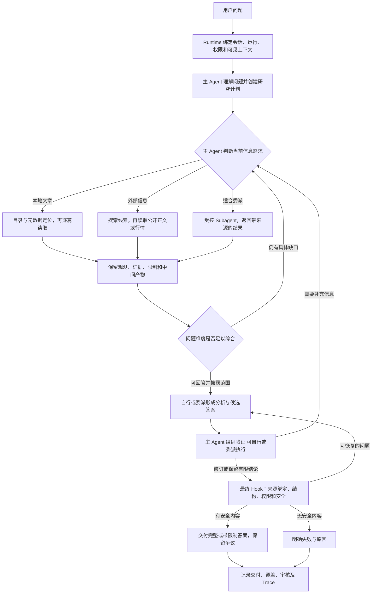
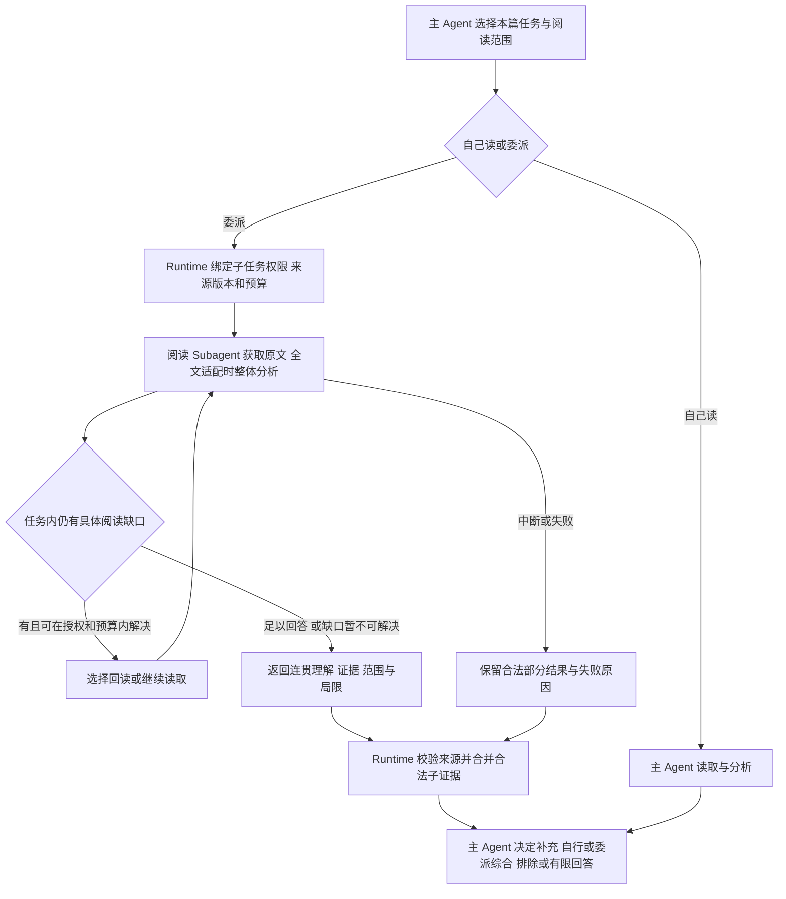

# 金融研究 Agent：系统架构

状态：飞书 revision 181 现行设计的规范化迁移版，待共同复核；2026-10-16 已补入用户确认的单篇分析交接、全文优先读法、可选阅读 Subagent、多篇综合与可恢复上下文，并明确分析可按需委派。下文表达应该如何运行，不宣称每条规则已被代码和真实模型验收证明。

来源优先级：原文第 14.12 节明确字段语义，第十四章裁决历史冲突；第十二、十三章中不冲突的规划、验证、稳定性及传输要求继续保留。原文“以代码实现为准”只视为当时实现记录，不允许代码覆盖已确认的产品设计。

迁移后经用户明确确认的变更记录补充现行设计；只更新已确认部分，草案不能覆盖本文件或接口契约。

## 1. 职责与插件边界

| 层 | 负责 | 不负责 |
| --- | --- | --- |
| 主 Agent | 理解问题、规划并维持总体链路，决定选材、读法、委派、覆盖与验证目标，接收和取舍结果，负责最终交付；分析、综合、复核及候选稿可自行处理或按需委派 | 越权访问、伪造观测、把模型意见直接认证为事实，或以委派代替总体目标与交付责任 |
| System Prompt | 总体目标、必要阶段、权限与证据边界、可见能力和资料入口 | 把所有金融问题写成固定流程或规定统一正文模板 |
| Skills | 按职责说明工具用途、分析或核验能力、输入输出与局限 | 强迫每题调用全部技能，或者用长提示替代接口校验 |
| 工具与 Subagent | 执行有边界的取材、计算、阅读、比较与复核 | 直接发布父任务终稿、擅自扩大权限或改变用户目标 |
| Runtime / Hook | 权限、真实观测、结构契约、证据绑定、预算边界、故障恢复、状态与 Trace | 判断每篇文章的金融价值、规定统一文章数量、替代主 Agent 的研究选择 |

设计文档指导开发，不整份注入金融 Agent 的上下文。实际运行通过插件配置装配短 System Prompt、需要的能力说明、任务上下文和来源。

2026-10-18 用户确认[变更 010](changes/010-progressive-capability-loading.md)：金融主 Prompt 保留研究不变量与 JSON 动作协议，附简短能力目录；七项 Skill 正文按 `skill.open` 读取，工具详细参数按 `tool.describe(name)` 逐项取得，不再初始注入全部正文与业务 Schema。仅计划和两项发现工具初始展示完整参数。说明查询不访问金融资料、不增加权限，可以在业务规划前澄清契约；业务取材和新版委派的先规划要求不变。旧配置无目录时仍兼容原装配。字段、权限和加载失败语义以接口第 9 节为准。

## 2. 总体职责链与分支

这不是固定工具 DAG。图中的可选取材分支可跳过、反复或组合；规划、实质分析后的验证及交付记录是阶段要求。具体工具顺序、是否需要联网及是否委派由主 Agent 决定。单篇阅读、跨篇比较、综合、复核和候选稿均可按任务委派，不限于取材分支；主 Agent 保持总体目标、衔接、结果处置与最终发布责任，不必亲自重复全部分析。安全问题只限制受影响内容，不能把一般证据争议当作来源伪造。

## 3. 规划、选材与停止

每轮研究先记录简洁但完整的 `research.plan`：用户要什么、回答维度、作者/时间/资产范围、证据需求、验证检查点及完成条件。简单问题不必展开成长计划。研究目标由主 Agent 更新；实际交付状态由 Runtime 依据可见结果记录，研究目标已完成不表示用户已收到答案。

需要本地材料时，从 Wiki 中的资料地图与授权目录发现可用来源，再用目录或元数据工具定位文章。Wiki 可以提供背景，但不能替代文章正文。不把每次请求都强制成同一条逐层导航；已经获得合法文章 ID 时可直接按权限读取。

普通概括和作者画像默认代表性取样并披露范围；用户明确要求“全部”“逐篇”时才以该范围穷尽为完成条件。“只出现一次”默认仅对已读样本负责。相对时间按本轮研究时钟解析，不能静默用文件修改时间替代发布日期。

主 Agent 在有意义的一组读取后，用 `research.coverage` 记录每个回答维度的依据、反例或限制、缺口，以及继续或综合的决定：

- 继续必须有具体 `next_need`，例如缺一个时间阶段或某位作者的相反条件。
- 已有足以回答的依据，重要条件/反例已检查或明确未检查，且没有预计会改变判断的具体信息需求时，可转入综合。
- 点名作者缺席、关键时间窗口缺失、强因果/预测或未解释冲突，是需要重新评估覆盖的理由，不是自动触发某个固定工具的关键词。
- 覆盖不足允许带限制回答；明确要求完整深读或逐篇分析而未完成，仍应如实记为业务目标未完成。

Runtime 防止无新增信息的重复调用，守住权限与预算并为综合/审核留资源；它不按每维固定篇数判断研究充分性。预算耗尽也不证明取材充分。

## 4. 单篇文章与文章集合

每篇文章独立保留作者、日期、版本、范围和 EvidenceRef。浅读围绕当前问题形成有限观察，不要求填满卡片字段。深读覆盖当前文章全文：能容纳在本次分析调用的可用输入预算内时，优先让分析模型看到全文并形成文章级整体理解；确实超出预算才分段并整合，保留跨段条件、时间、论证关系及限制。不再将按 100 行分段提取设为深读的必经路线；工具分次获取正文与模型分次分析是两件事。

2026-10-16 用户确认：主 Agent 选用单篇分析能力时，以围绕当前任务的连贯文章理解为主要交接内容，保留适用条件、局限和回查证据；结构化主张按需附带或生成，不是所有文章理解的必选主通道。分析正文不强制统一章节，也不要求每篇形成同一种持久化产物。主 Agent 提供原问题、单篇任务、文章与阅读范围，按需附加关注点；返回的自由分析与可核对外层分开，来源版本、实际观测范围由 Runtime 绑定。确认记录见[文章理解复核](changes/003-article-understanding-review.md#4-已确认的交接形式)；职责语义见[接口契约 3.1](finance_agent_interface_contracts.md#31-target-single-article-handoff)，正式版本化字段见[接口契约第 8 节](finance_agent_interface_contracts.md#8-versioned-research-integration-contract)。新版可选路径已实现，旧 claims 路径仍兼容；离线结果不证明真实理解质量已达标。

ArticleCard 是可选证据产物，不是每篇文章的强制输出。无相关观点可返回明确的无相关内容结果，现有卡片路径保留 `no_relevant_claims`；不能为完成结构而编造观点。分段深读需整合为文章级理解；全文已在一次分析中形成整体理解时，不为凑阶段强制再增加一次归并调用。旧 `article.study` 路径可关联 `research_note`；新交接选用 v2 完整文章理解产物，不强塞进旧笔记条目或卡片。卡片和笔记仍可作为辅助产物关联，段落证据保留，派生记录不替代原文。主 Agent 直接阅读和按任务委派均可，不能把所有全文无来源地拼成一篇。

全文适配须计入任务指令、必要上下文、输出余量及模型配置，不能以行数、原文字符数或未经实测的“舒适窗口”单独判断。取得原文、把原文送入分析模型、生成有效分析和语义质量是不同维度；失败或部分完成不能统一写成深读成功。有用的部分理解仍应保留并披露限制。版本化任务/结果与存储契约已选定；具体容量阈值、超长分段及回读实现、重试次数和运行配置仍需实现前复核或实测。

文章状态分三层，不是五个互斥集合：

| 层 | 状态与含义 |
| --- | --- |
| 发现 | `listed_articles`，附作者、日期、来源、分页与 `listing_complete`；未列出不证明不存在 |
| 读取 | `unread / partial / complete / failed`；完整与否以当前版本实际观测范围判断，工具失败不是读到了正文 |
| 使用 | `undecided / used / excluded`；used 可区分 primary/background，排除不表示从未读取 |

`planned_articles` 不是最终使用集合。最终 `used_articles` 由答案实际引用和依赖的合法 EvidenceRef 反查，主 Agent 的计划声明不能独立充当使用证据。已读但无关的文章不需要在答案中强行引用。

## 5. 跨文章分析

在用户问题范围内，保留各文章独立观点和条件，再比较同一议题的共识、分歧、变化或互补。对时间变化须区别事前预测与事后解释；对不同主题或不可比条件，允许没有可支持的关系。

可以直接由主 Agent 综合，也可以按任务委派跨篇比较与综合，或选用 B3 启发的逐文档视角及综合工具。主 Agent 指定原问题、子任务目标、授权材料与预期交接，接收结果后处理缺口、冲突及是否采用；不要求为了履行总体责任再亲自重做子任务的完整分析。这里是可委派的能力，不是新增固定角色、固定层数或默认递归委派。旧 `research.synthesize` 与 analyst 的当前输入限制仍见[接口契约](finance_agent_interface_contracts.md)，不能直接当作新能力已经实现。

综合执行者应能接收单篇的连贯理解及其来源、日期、条件和局限，不要求先把所有理解转成 claims。子任务可以在授权内展开理解或回读，超出范围的具体需要交回主 Agent，由其决定补充授权、自己处理或另派任务。完整理解适配实际执行者的本次模型输入预算时优先使用，不为节省 Token 强制再摘要；具体工作视图与恢复规则见第 8 节。主 Agent 无需先把全部原文和理解重复装入自己的上下文才能委派。

读取覆盖、任务分析覆盖、综合考虑范围分别记录。正文取得、产生有效文章理解、被综合执行者纳入比较不是同一事实。综合结果说明实际考虑的材料、尚未处理的范围、排除及理由；这些分析判断由 Agent 提供，Runtime 校验标识、版本、真实输入与证据关系，不认证“没有遗漏”。明确要求全部时，不能把所有子任务返回自动视为已完成全量综合；没有处理的范围须保留缺口。纳入考虑不等于逐篇写入答案，无关材料可排除，重复观点可合并。具体语义见[接口契约 4.1](finance_agent_interface_contracts.md#41-target-multi-article-synthesis-and-context-handoff)。

关系必须回到参与文章的正文。两位作者同意只证明观点一致；相互转述或共用数据不构成独立事实验证。时间线和观点矩阵是派生视图，不是新的事实来源。

## 6. 验证目标、结果与修订

实质分析后必须进入验证阶段并记录 `research.checkpoint`。主 Agent 选择对答案重要的 `review_targets`，不是 Runtime 把每句话拆出来一律审核；普通元数据先做来源和权限校验，不进入同等强度的金融语义审核。

| 主张类型 | 核验重点 |
| --- | --- |
| `author_view` | 作者真的表达了什么，保留归因、语气、时间、条件；无需默认联网判作者对错 |
| `objective_fact` | 数字、事件、单位、日期、行情口径与证据对应 |
| `prediction` | 预测者、方向、期限、条件与是否到期；未到期不判成已实现 |
| `causal_explanation` | 机制归因、时间对齐、替代解释；相关或同期发生不等于因果获证 |
| `model_inference` | 明确前提和输入证据，不能冒充作者原话或客观事实 |
| `personal_context` | 来源是 Wiki、持仓或用户陈述，不能自动升级为市场事实 |

核验可用已读正文、公开网页、行情、`research.verify` 或受控 Subagent。主 Agent 也可以记录“不需要外部核验”。来源数量、不同模型调用和不同角色名称都不能自动证明独立性。

对外部事实作 `supported/refuted` 判断必须有本轮读取、口径匹配的独立外部证据。缺资料时，有具体需要就继续查；仍无法判断则保留 `inconclusive` 或该结果类型定义的证据不足状态。不同接口的枚举不能混用。未到期预测才可用 `not_due`；保真转述用 `viewpoint_faithful`，合理推断用 `reasoned`，均不等于事实认证。

作者与外部证据冲突时并列保留：作者原观点与正文、反向证据的日期/口径、冲突理由及未裁定争议。Typed-RARR 是本项目适配，不是论文已验证整套金融系统；其研究、对齐和修订用于改进表达，不能无声删除忠实归因的作者观点。

2026-10-17 用户确认[变更 008 方案 A](changes/008-review-convergence-and-draft-delivery.md)：审核执行覆盖、目标支持程度与交付处置分别记录。非空 `limitations` 不意味着审核失败；真实缺少目标材料或有效结果仍需记 partial/failed。主 Agent 在现有共享预算内自主补证、定向修订、复审或带局限交付，不再固定全文三次退回。相同目标及依赖输入可以复用完成的核验（包括证据不足），不能把未核实升级为事实认证。依赖不明确时保守重审，不凭目标 ID 相同复用。字段只在接口第 5.2 节定义。

## 7. 结构恢复、审核失败与交付

最终正文由主 Agent 决定如何组织和发布，分析和候选稿可委派生成；接收后不强制为体现参与而重写，但须处理已知重要局限、冲突和验证结果。工具动作、审核目标和结果使用结构化信封。正文形式自由与机器接口有结构并不冲突。

结构错误依次反馈原模型、进入有边界的结构修复能力，再保留正文并标注审核未完成。修复只能修结构，不能新增事实、替换原文或假装完成研究。传输失败是另一类问题，不能给未返回内容的请求追加 JSON 不合规指责。

最终 Hook 负责来源真实性、权限、EvidenceRef、目标结构、重要限定和缺口披露。对于一般争议、核验不足、审核模型出错，应保留完整研究稿或可安全保留的完整部分，降低确定性并显示未完成审核。只有相关内容确实有伪造、越权、断链等安全问题时，才限制该内容。

`source_only` 是在没有可安全保留的分析时可用的交付形态，不是审核异常后的必然降级。不要求为了交付把尚未核实的内容说成已验证；也不因不能证明结论而让已完成的有归因分析全部消失。

完整公开候选在语义审核前形成运行内不可变检查点；修订、审核和选择记录绑定候选版本与实际来源快照。普通后续失败、预算结束、重审未收敛时重新检查已有候选并带局限交付，不仅依赖最后一次请求的结果。新稿失败不覆盖旧稿，回退不能洗掉仍适用的已知问题；来源变化、越权、无效引用及明确的确定性错误继续限制受影响内容。存储失败如实记录并保留合法内联稿，不制造已保存 ID。此阶段不承诺进程崩溃恢复、跨文件事务或恰好一次发布。

计划中的研究目标可以带理由 blocked；Runtime 根据实际交付记录 delivery。完成的含义、覆盖和置信度分别定义，不能一键全部标绿。

## 8. Subagent 与上下文

用户于 2026-10-16 选择：专门的单篇阅读能力采用具有只读工具循环的可选阅读 Subagent，而不是只由代码组织一次分析调用。主 Agent 仍可自己阅读；委派时，阅读 Subagent 根据任务选择授权范围内的读取、回读与停止，遵守第 4 节的全文优先与连贯理解交接。一次形成充分理解即可返回，不要求每篇启动、不要求固定轮数或反复回读。现已注册并接通显式版本化 `analyst@2.0.0` 配合阅读/综合 Skills，不分别新增固定 reader/synthesizer 角色；旧 `analyst@1.0.0` 保持兼容。

2026-10-26 用户批准的 [103 Profile 与核验闭环](changes/103-h2-agent-profile-and-review-loop.md)进一步明确职责分层：Root 创建每篇 Analyst 任务并给出用户层核验政策；Analyst v2 产生带核验目标的版本化草稿，依据 `required/auto/off` 请求文章级 Verifier；Runtime 从冻结 Profile 装配权限和 Brief、生成不可变草稿并派发受限 Verifier Task；Verifier 只返回绑定草稿 revision 的 ReviewReport；Analyst 逐项处置后交 Root。Root 仍负责跨文档综合和最终答案审核。103 的轮次状态和回归验收覆盖旧段落中“尚未登记新增 Profile/递归授权”的历史描述，013 调度数据模型不变；实现状态不由文档批准自动推定。

Analyst 提供被分配材料的分析；Verifier 在被委派外部核查时读取独立来源；Skeptic 寻找反例、遗漏条件、口径混淆和推断跳跃。分析与综合职责不限于逐篇提炼，可由具备相应契约与授权的子任务承担跨篇工作；不因本文直接增加角色注册或改变旧输出 Schema。主 Agent 决定是否调用及采纳什么。阅读不是自动的独立事实核验；外部取材仍受父任务、角色工具和本轮权限约束，不默认要求联网，也不能因命名为阅读角色就绕过来源限制。子 Agent 不能直接发布终稿、修改父计划或访问未授权资料。

委派应有任务目标、范围、可见材料/ID、允许工具、预期返回结构及父子运行关系。阅读与综合输出保留任务导向正文及可核对外层，复核角色按各自判断契约返回；不能用旧 AnalystOutput 的 claims 形状反向强制所有分析结果转为主张列表。Runtime 接收后校验并合并合法证据，主 Agent 处理结果与缺口，再用于答案；不能把子 Agent 一句话当成已经观察的独立来源。具体交接与恢复见[接口契约 3.2](finance_agent_interface_contracts.md#32-controlled-reading-subagent)及[4.1](finance_agent_interface_contracts.md#41-target-multi-article-synthesis-and-context-handoff)。

循环始终受任务与资源边界约束。已确认初始上限为整轮 60 分钟、子任务最多 20 分钟，各预留最多 10/2 分钟收尾；剩余预算不足时子任务更短，信息充分时提前结束。物理请求总账和输入配置见变更 004。来源有效的部分结果可以交回，但不能把失败子任务改记为成功，也不能声称没有证据支持的“已深读”或“已核验”。这不等于已实现子任务的持久化队列、取消或重启恢复。

上下文保留三类可区分材料：原文及实际观测、完整文章理解、当前综合工作视图；任务状态、未决问题和恢复路径另行保留，不因压缩删除。保存完整结果不等于换出，也不证明它已经进入某个执行者的模型输入。完整理解适配时优先用于分析；只有真实压力出现时才换出或缩减当前可见内容。已在上下文的原文不因子任务成功就强制清空，也不默认把所有子任务原文再复制给主 Agent。

主 Agent 可自行或委派围绕当前问题整理工作视图，保留关键条件、反向观点、时间差异、局限及需展开的材料引用；不统一缩成每篇一句话。Runtime 负责预算边界、源版本、保存和按授权 ID 恢复，不替模型挑选有价值的句子。工作视图记录上游理解与原文的来源关系、范围和版本，不是原文或完整理解的唯一存本，也不是独立证据。新版已接通运行内工作视图和授权恢复；子任务按需只读访问父任务明确授予的材料快照或句柄，而不是获得整个父存储的访问权。

综合发现关键条件不清时，执行者可在授权内依次展开完整理解、回读相关正文或返回具体缺口；外部核查仍按任务需要决定。不能仅对摘要再摘要就声称核对过原文，也不强制每次走完这些步骤。来源变化使相关派生理解与视图过期，恢复不能静默混用版本；源版本依据同步后的文章索引校验，不宣称实时文件监控。子任务失败时按真实范围保留合法部分结果。交接与覆盖语义见[接口契约 4.1](finance_agent_interface_contracts.md#41-target-multi-article-synthesis-and-context-handoff)，字段、授权材料与 v2 运行内文件存储映射见[第 8 节](finance_agent_interface_contracts.md#8-versioned-research-integration-contract)。暂定容量与恢复配置已编码，服务真实容量及更广生命周期未验收。

run-local 工作状态与长期 Wiki 分开，不自动把中间推断写回用户事实。上下文具体阈值属于可配置工程策略及实测问题，不是模型最舒适窗口的结论。重复恢复应引导产生进展，但不能变成固定金融分析法。

2026-10-17 用户选择的1.0容量边界见[变更009](changes/009-context-capacity-and-v1-baseline.md)：金融研究配置最高1,000,000 tokens，较小显式额度优先，保留输出及安全空间；默认在参考容量70%时触发原样换出，目标60%。替代变更004的48000输入默认及旧约39808触发点，不改变研究时限、审核和传输。GPT中转站的1M仍是配置假设而非容量认证，比例也不是最优质量证明；复杂压缩/工作视图调度留给2.0。

## 9. 模型传输稳定性

JSON 工具契约、有界格式纠正、分类诊断、近期大观察卸载与分页恢复遵循
[变更 006](changes/006-json-tool-contracts-and-recovery.md)。不使用供应商原生
Function Calling；Responses 文本接口与工具执行协议分别判断和验证。
H2 文本动作如果出现模型尾部 transcript 或有限 XML-like 外壳，遵循[变更 083](changes/083-h2-bounded-action-json-recovery.md)：只提取并校验首个完整动作对象，尾部只留在原始审计中，不能成为观察、证据或下一轮提示词；自然语言前缀、首对象非法后的第二对象和半截 JSON 仍拒绝。

2026-10-17 用户确认增加可选 Responses 文本传输，见[变更 007](changes/007-responses-transport-and-delivery.md)。
现有默认配置保留；`gpt-responses` 使用完整本次输入和 `store=false`，不使用远端会话、
原生工具或自动切换。两种协议分别判断终态，再进入同一 JSON 动作、权限与证据校验。
具体请求、完成/截断/失败语义与诊断见[接口 6.4-6.5](finance_agent_interface_contracts.md#64-optional-responses-text-transport)。

保留飞书第 13.4 节于 2026-10-15 确认的 OpenAI-compatible 可配置 SSE 设计。它是模型侧传输，不是页面显示 Trace 的 SSE，也不改变研究方法。参数和具体完成条件见[接口契约 6.2](finance_agent_interface_contracts.md#62-optional-model-side-sse-transport)。

必须有明确完成信号才将内容作为完整 ModelResponse 使用；片段不能执行工具或发布，推理增量不是答案。断流、损坏和提前 EOF 丢弃该次缓冲并按边界重试，不拼接两次生成。输出截断即使 JSON 可解析也不是完整结果；鉴权失败不盲重试。超时、限长、退避、实际尝试次数和脱敏诊断须可追溯。

原有 600 秒单次流上限与 900 秒配置范围等传输参数不是新的研究预算设计，更不代表完整研究必然能在该时间内完成。单次流成功、运行交付和业务验收必须分别判断。

## 10. 状态、Trace 与验收

| 维度 | 规范含义 |
| --- | --- |
| `trace_contract` | 关键事件和来源关系是否可追溯；不证明结论正确 |
| `delivery_status / delivery_mode` | 是否交付安全结果及其形态，不表示验证成功 |
| `evidence_coverage` | 用户问题的资料范围是否覆盖 |
| `answer_audit_coverage` | 终稿重要目标的审核覆盖，不是资料范围覆盖 |
| `semantic_review / verification_status` | 审核执行完整性与核验结果，不自动等于 supported |
| 研究置信标签 | 具体主张的依据强弱与理由，不是概率，不复用 Wiki 数值 confidence |

具体字段和兼容别名只在接口契约中定义。Trace 保存任务、时钟、配置版本、计划、工具参数与返回、真实来源、父子委派、上下文恢复、验证结果、修订和交付状态，不要求暴露模型隐藏思考。

工具动作与观察须按真实调用ID关联，包括失败调用；不能按成功结果的顺序猜测账本位置。网关前拒绝时无记录则明确留空，不借用下一次调用。对应接口及批次后记录修复见[变更009第6节](changes/009-context-capacity-and-v1-baseline.md#6-冻结批次后修复工具调用与返回的真实关联)，不改变主Agent的研究判断。

验收同时看问题是否被回答、结论是否有依据、Trace 是否符合设计。通过确定性测试不代表语义正确；真实模型一次成功不代表稳定或商业化。具体使用既有 30 条 Query 与 Trace 检查点，不为“通过”临时放宽标准。

## 11. 实现基线与待讨论工程设计

现有代码保留 Python、FastAPI、自研 Harness、SQLite、原生前端和已实现的金融插件。代码入口和离线验证见[开发流程](development.md)及[产品分离记录](changes/001-finance-research-fork.md)。文档迁移之后另行批准并实现了[版本化研究迭代](changes/004-versioned-research-implementation.md)，没有改数据库、队列、前端或原项目。

飞书中“代码尚未完成”的段落是写作时的历史观察，不能原封不动充当今天的缺陷清单。例如当前 `article_study.py` 已有文章级归并和 `research_note` 保存路径，但其所有失败分支是否合规仍需专门验收。

Run/Subagent 持久化生命周期、异步队列、事务与幂等、重启恢复、多用户隔离、并发量和服务指标还没有在本次迁移中选型。不先写成已批准的表结构或技术栈；完成本轮文本确认后，再逐项研究和决定。
