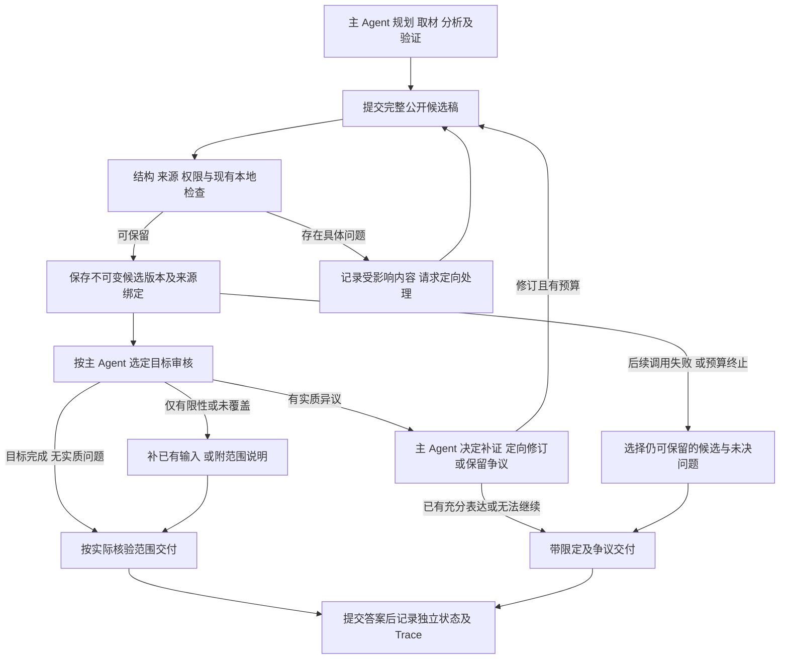

# 审核收敛与完整分析交付优化

日期：2026-10-17。状态：**用户已选择方案 A，批准按本方案推进 1.0。第一阶段已实现；充值后真实批次 r008-02 的六次固定复验及人工核对已结束。四次完整分析的内容/证据通过，两次仅材料的内容不通过；按三栏均通过的整体验收仅2/6通过，细节见8.4。第9节三项技术缺陷已在冻结批次结束后修复，离线回归与真实结果分开记录。第二阶段上下文与旧 analyst 元数据仍单列，不冒充已完成。**

依据：[系统架构第 6-8 节](../architecture.md#6-验证目标结果与修订)、[接口第 5-6 节](../finance_agent_interface_contracts.md#5-review-payload-d)、[变更 007 验收](007-responses-transport-and-delivery.md#6-实现和验证记录)。本设计细化已经确认的研究自主性与安全完整分析保留原则，不重新选择 A-E，也不宣称其工程组合已由论文或线上实验验证。

## 1. 问题、已有要求与本轮边界

| 实际观测 | 对照设计的判断 | 优化方向 |
| --- | --- | --- |
| Q04 有 4214/3734 字完整候选，最终仅交付 707 字材料 | 审核失败应保留安全分析，已有实现未落实到中断分支 | 审核前保存候选，修订失败不清空上一版可保留正文 |
| Q14 有 2469 字比较候选，最终仅交付 2202 字来源说明 | 有输出不等于回答问题；普通审核局限不应迫使 source_only | 把审核结果转为修订/限定/争议，不一律退回全文 |
| 两题均有 `issues=[]`，却因非空 `limitations` 返回 revise | 审核执行覆盖与事实是否可证实被混淆 | 自由文本局限只作说明，不作为失败开关 |
| Q14 审核部分比较目标只看到两篇，而正文使用五篇核心材料 | 存在真实的目标输入覆盖缺口，不能全部归为审核误判 | 按目标依赖补齐本轮已读材料；不足则明确未覆盖目标 |
| Q14 有 31 次 context.open、21 条重复恢复提示、8 次换出 | 并非所有恢复无用，但进度记录没有充分避免重复取回 | 使用可见工作视图，区分任务进度与具体页面恢复需求 |
| analyst 把一条 coverage_limit 工作范围说明放入 claims，导致缺绑定警告 | 元数据与金融主张分类不合适，不证明作者观点造假 | 工作状态与可引用主张分开，不能按名字豁免某条 claim |

前两项保留原则、局限不等于事实错误、元数据不进入同等金融审核，已有设计依据。用户本轮确认方案 A：主 Agent 在既有预算内自主追加，先让 1.0 审核和完整分析交付正常运行；不借此次修复扩展后端架构或重新设计金融研究方法。

不改变默认模型、传输协议选择、研究时限、工具权限、主 Agent 的选材/读法/委派决定；不引入 Agent 框架、数据库表、队列、前端改造或跨模型自动降级。不用扩大预算掩盖现有循环。只保留完整公开分析，不保存隐藏推理或拼接断流正文。

## 2. 总流程：研究自主，交付有检查点

这不是固定工具 DAG，也不要求额外 Subagent、联网或标准答案章节。主 Agent 仍决定研究方法；Runtime 保管版本、实际来源、边界和状态。没有候选或所有分析都有无法隔离的安全问题时，才退到真实材料；无安全内容可交付时为 blocked。

## 3. 审核策略：分别回答三个问题

### 3.1 执行、支持程度与交付处置分开

| 维度 | 回答的问题 | 不能由什么替代 |
| --- | --- | --- |
| 审核执行与输入覆盖 | 哪些选中目标得到了有效审核？必需且已经读取的材料实际传进去了吗？ | 非空 limitations、目标数、模型调用成功 |
| 目标核验结果 | 作者是否这样说？事实得到什么支持？预测是否可检验？因果连接缺什么？ | “审核完成”“作者一致” |
| 表达和交付处置 | 原样保留、补限定、定向修订、并列争议，还是限制具体内容？ | 单一 accept/revise 或整个回答通过/拒绝 |

继续沿用既有主张类型和核验枚举，不增加另一套金融真假标签。`limitations` 可在审核完成时存在，也可描述真实未完成项；必须由结构化覆盖记录说明区别，不能仅以字符串是否为空决定。`issues=[]` 同样不自动证明覆盖完整。

关键分支：

| 情况 | 应采取的处理 |
| --- | --- |
| 作者观点已忠实转述，未核验其市场正确性 | 可完成观点保真审核；保留归因，不默认联网或全文重写 |
| 已检查现有证据，认为不足以证明机构清算等事实 | 审核可以完成，结论为证据不足；限定表达，不因未知事实永久重复审核 |
| 比较目标声明依赖三篇，实际只传入一篇 | 真实输入缺口：补已有且获授权的正文或理解；补不齐则保留覆盖 partial，而非认定作者观点错误 |
| 目标结果缺失、格式错误、调用失败 | 按既有有界恢复处理，保留已完成目标；未完成目标不能伪装成通过 |
| 字段互相矛盾，或只有笼统“范围有限”无法解释覆盖 | 在共享预算内做一次仅元数据澄清；失败标 partial/failed 并交付可保留分析，不要求全文重写 |
| 有遗漏条件、过度归因或确定性过强 | 主 Agent 根据具体目标定向修订或标争议，不自动删除作者观点 |
| 明确伪造来源、越权、无效引用或已知算术矛盾 | 保留独立的本地边界；处理受影响内容，不能用“审核未完成”免责发布已知错误 |

`external_check_needed=yes` 不等于 Runtime 强制联网：主 Agent 可以补查，也可以说明未查到、无法查或证据不足。但没有匹配的独立证据时，不能写 supported/refuted 来认证外部事实。证据之间冲突仍并列展示作者观点、反向材料和未裁定部分。

### 3.2 定向修订与增量复核

向主 Agent 返回目标、原稿位置、实际材料、问题、建议与缺口，不统一称“你的全文有错误”。没有实质问题时，不能只因覆盖说明反复生成全文。

修订后复核受影响目标及其依赖：目标断言、附近的重要限定、作者/时间、问题、个人背景、来源正文/版本、审核契约任一变化都可能使旧结论失效。仅段落顺序调整不一定需要重审，但依赖关系无法可靠确认时不复用成功结果。

缓存复用须绑定目标语义输入、相关原文和上下文，不只绑定 target_id 或 EvidenceRef，也不能因为整篇 checksum 改变就必然重审全部目标。已完成的 inconclusive 等结果可以在相同输入下复用为“已审核但未能证实”，不能升级为已验证。缺输入/失败尝试可保留诊断，不缓存成成功审核。

**重审控制：用户已选择方案 A；方案 B 仅保留为未采用的比较记录。**

- **方案 A，推荐：主 Agent 自主追加，Runtime 守边界。** 不固定全文三轮；主 Agent 判断是否补证、定向修订、再审或直接带争议交付。相同审核输入复用结果；新增请求须服从现有共享预算，不能通过新 target_id、重置局部计数绕过根预算。没有进展时提示改为处理缺口/交付，不由 Runtime 判金融结论是否足够优秀。
- **方案 B：固定一次定向修订，再做一次增量复核。** 超出后带限制交付；更容易约束时延，但可能提前结束仍有价值的研究。相同的候选保留、真实来源与安全规则仍适用。

两种方案都不能保证模型一次判断正确。方案 A 更符合本项目质量优先、宏观约束微观自主的要求；其是否减少无效循环必须实测。

## 4. 候选稿保留、故障与状态

### 4.1 候选版本与交付选择

主 Agent 每次提交完整公开候选后，在进入可能耗时的语义审核前保存不可变版本。复用既有 run 目录与原子写入能力，不改数据库；本轮只覆盖当前运行可正常处理的异常，不承诺进程崩溃后的自动恢复或恰好一次发布。

拟记录：`candidate_version`、`answer_checksum`、公开正文与输出、父版本、选中目标、来源快照标识、本地检查结果、目标审核结果、未决问题和失效原因。具体接口确认后再统一进正式契约，不让插件另造一种同义结构。

- “已接收完整稿”“来源定位通过”“语义审核完成”“已交付”是不同事实，本地检查不能认证语义正确。
- 修订采用新版本，不在原稿上就地覆盖。收到空正文、断流、格式失败或无法保存的新版本，不覆盖上一版候选。
- 每版审核结论绑定该版和实际材料；新增证据/来源版本变化不能静默沿用原来的已验证标签。
- 保留最新稿不等于总选最新稿。选择当前仍可保留的版本；较新稿被判不可用时可使用之前可保留的稿。
- **不能借回退洗掉已知问题：**新审核指出旧稿也含有的问题，旧稿同样需标注或限制。不能只按 candidate_version 回退就忽略异议；无法跨版本定位时保留文档级未决提示，而非宣布问题已修复。
- 清除历史异议时，须确认本次完成的目标审核实际包含争议原文；仅换 `answer_context` 选中另一段不能清除。争议段落已改写且无法机械确认对应关系时，采用该目标的全文上下文重审，不让 Runtime 判断金融语义。缺材料或调用失败属于执行缺口，补齐输入后同一任务成功重审可以关闭；允许追加真实证据，不要求 EvidenceRef 列表原样不变。普通交付与中断回退均须检查真实独立复核经历，不能重新发布已经被拒绝的虚假复核声明。但“未完成独立复核/尚缺状态说明”本身不是来源造假：未声称复核成功的安全稿仍保留，中断交付由 Runtime 附加真实未完成说明，不为缺少特定措辞而丢弃完整稿。

中断处理统一读取候选记录，而不只依赖本次失败请求的 `preserved_final_output`。预算终止、模型/工具失败、门控未收敛分别保留真实 stop reason；普通后续故障不自动抹掉之前完整分析。权限/来源安全错误仍须重新判断受影响范围。

### 4.2 有限审核与安全交付

有完整可保留分析但没有审核资源时，直接进入本地最终检查与 qualified 交付，不再为“走满第三次”调用模型。不得为了检查引用重新无目的取材。需要限定的位置可可靠绑定时，由主 Agent 修订或附目标级说明；无法定位普通异议时，保留完整原稿并在显著位置列出争议和未核实范围。

这不允许用一个总免责声明保留已知伪造来源、越权泄露或明确错误的确定性数值。此类问题能隔离就限制对应内容；无法安全隔离且没有其他可用候选时，退回真实材料或 blocked。已有作者原文与合法反驳尽可能保留，不通过正则静默删除整行表格或让 Runtime 重写金融论证。

继续使用现有独立状态：

| 事实 | 状态要求 |
| --- | --- |
| 完整分析附局限送达 | delivery done，通常 qualified；不因为正文长就记 full 或通过业务验收 |
| 选中目标已审核，但事实仍 inconclusive/预测未可裁定 | 审核覆盖可 complete；verification 不得因此一律写 verified |
| 部分目标调用失败 | answer_audit_coverage partial；无有效审核才 failed；披露保留的审核结果 |
| 未执行独立外部核查 | 不能称独立复核或事实已确认；viewpoint_faithful/reasoned 不改名为外部 supported |
| 只交付来源，未回答研究问题 | source_only；普通研究题的内容验收仍不通过 |

不更改规范枚举；最终映射须按目标类型和实际结果修订并补测试。所有状态都在答案成功提交后写入交付记录，不提前标 done。若在最后审核期失败，错误提示也不能声称“从未生成综合答案”，而应说明“已有候选、审核/后续处理未完成”。

## 5. 上下文与 Subagent：把进度变成可用材料

本节是第二阶段优化，不在第一阶段以强制委派、强制换 v2 或增加阅读次数绕开交付缺陷。

- 主 Agent 自行或委派整理问题相关的工作视图，保留双方观点、日期、条件、分歧、未决问题和原文句柄；不用统一的一句话摘要取代全文理解。
- 当前工作视图必须在预算内实际出现在下一位执行者的模型输入中，不能只有“保存成功”的 receipt。过大时由主 Agent 调整范围或委派，不让 Runtime 判断删哪些金融观点。
- 区分 research.plan 的任务进度和某份材料是否仍需恢复。更新待办可证明阶段进展，不能自动证明反复恢复同一页的问题已解决。
- 相同内容/范围再次恢复且无新的使用需要时，反馈已有工作视图、已读范围和具体未决问题，优先让主 Agent 决定使用现有分析、精准回读、更新视图或交付。新分页、源版本变化、核对引句和新审查问题不能机械判成无用重复。
- 保存研究视图不清空原文、证据和恢复链，不重置整个运行的恢复历史。对必须保留的大型视图仍计入实际输入预算，不承诺某个固定窗口是模型最舒适的设置。
- 实际 v2 触发样本和旧版结果分别验收，不以给工具换名证明新路径已经使用。

旧 analyst 的工作范围/失败说明建议放入独立可选 `notes` 外层，研究主张仍保留 EvidenceRefs。该扩展须同步严格 Schema 和旧结果兼容；不根据 claim_ref 等于某个特殊字符串就绕过证据检查。范围说明可依赖 Runtime 的任务/读取记录，不伪造文章 EvidenceRef；其中夹带金融判断时，不因位于 notes 就可以当已验证研究结论使用。

## 6. 接口落点、验收与实施顺序

以下是设计映射，不是已经存在的新接口：

| 部件 | 主要落点 | 拟新增的检查信息 |
| --- | --- | --- |
| 目标级覆盖与核验分离 | finance/answer_audit.py、既有审核 Schema/Prompt | 已检查/未检查目标、实际输入范围、缺口类型、处置建议；limitations 不驱动失败 |
| 候选版本与中断交付 | finance/answer_delivery.py、harness/agent_runtime.py、agent_loop.py | 候选版本/checksum、来源、本地边界、未决问题、选择或排除原因 |
| 增量复核 | 既有 AnswerAudit 与运行内缓存 | 目标与依赖输入签名、复用来源、失效原因；不按旧全文校验和盲目复用 |
| 上下文有效进展 | agent_loop.py、现有 research.artifact/v2 工作视图 | 恢复范围/原因、实际可见视图、进展释放原因和后续重复情况 |
| 工作范围说明 | runtime/subagent_outputs.py、对应 Prompt/证据审计 | notes 与 claims 分开；不扩大 Subagent 授权 |

Trace 优先扩展既有 `answer_claim_audit`、`answer_review_resolution`、`context_progress_gate` 和 `research_delivery`；仅在确需记录候选接收/版本选择时新增候选检查点事件。记录重要决策、输入与证据关系，不记录隐藏推理。不能只修改 Prompt 而不打通错误分支及可观测性。

实施与停止顺序：

1. **确认后先处理审核与交付。** 正式更新架构/接口/验收，再实现目标状态拆分、候选保留、失败收尾和选定重审策略；不先调整预算或文章分析方法。
2. **先做零模型故障回放。** 用隔离 fixture 复现 Q04/Q14 的状态组合，不能把私有原文写入测试仓库。重点检查：limitations 非空但目标全部 retain；真实缺输入；修订请求断流；审核中时间归零；较新稿非法而旧稿可用；已知问题不能借旧版回退消失；来源变化；表格不被破坏；无完整候选才材料回退。
3. **补状态和缓存回归。** 审核完成但 inconclusive；部分目标失败；元数据矛盾；完整候选只收到半截；已知伪证据不能用免责声明放行；新目标不重复审旧目标；限定/来源变动必须使相关缓存失效。
4. **单独处理上下文与元数据。** 用受控上下文压力验证工作视图实际可见、连续分页不误判、重复恢复不借计划文字换壳无限释放；验证旧/新 analyst 兼容。没有压力则不为验收强制压缩。
5. **经授权再做真实复验。** 建议同一 profile、冻结语料和原 Q04/Q14 各三次，保留每次失败；生产和诊断预算分别注明，不在运行中自动换模型。分别报告传输、有效工具/审核、交付、内容/证据/链路；不能仅按长度或 delivery done 算成功。
6. **固定本轮测试次数后收口。** 不无限“修改到某次通过”；未通过按具体设计节点归因报告。多次个人研究复验也不代表商用 SLA、并发或全部 30 题通过。

正式行为与新增字段统一见架构第 6-7 节及接口第 5.2 节。先实现第一阶段并做离线故障回放；第二阶段和付费业务复验分别记录状态，不能用设计确认反写此前失败为通过，也不把离线回归等同金融质量验收。

## 7. 第一阶段实现与验证记录

### 7.1 已接通的代码

| 职责 | 实现落点 | 实际行为 |
| --- | --- | --- |
| 选中目标审核与增量复用 | `src/policy_impact/domains/finance/answer_audit.py` | 记录目标实际输入、缺口和完成情况；非空局限不单独驱动失败；相同语义输入可跨 ID 复用；材料/限定/上下文变化失效；矛盾覆盖元数据仅澄清一次 |
| 候选版本及未决问题 | `src/policy_impact/domains/finance/answer_candidates.py` | 运行内不可变正文和审核文件、原子保存及内联兜底；来源快照、本地重检、较新不可用时选择较早可用稿；按实际上下文关闭问题，不靠空目标、改名或无关片段消除异议 |
| 故障交付与状态 | `src/policy_impact/harness/agent_runtime.py`、`src/policy_impact/domains/finance/answer_delivery.py` | 审核前捕获完整稿；普通后续故障保留安全正文、表格和争议；独立复核真实性检查在正常及中断交付共用；交付、审核完成和事实支持分开 |
| 模型可见契约 | `src/policy_impact/skills/schemas.py`、`plugins/prompts/finance/00_system.md`、`plugins/skills/finance/evidence_review.md` | 可选目标上下文与继续/带局限交付选择；不再固定全文三轮，主 Agent 仍选择选材、委派、重要目标和修订方式 |

另修复既有本地引用检查：遍历结构化输出的字符串值，而非把 JSON 字段名 `evidence_refs` 当成一个未观测的 EvidenceRef。仍检查值中的真实引用，不豁免伪引用。

### 7.2 离线复核

- 用隔离临时语料和脚本模型回放，不读取私有文章、不联网调用模型、不使用凭证；不是将真实 Q04/Q14 原文拷入单测。
- 最终审核/候选/交付/Runtime 四模块专项 **250 项通过**；此前专项结果为其子集，不叠加计算。
- 独立审查发现并补回归修复三项：无关上下文清除异议、终止回退重新发布虚假独立复核声明、补齐输入后平铺缺口不关闭。额外检查完整/部分批次和改写后无法定位的保守重审。
- 复核还发现将“缺独立复核状态说明”误当安全缺陷会丢弃真实完整稿，已分离完成声明与状态缺口，并补 gate_blocked/model_error 回放、否定/待做声明、全局免责声明不能掩盖假复核经历的夹具。未复核安全稿保留，由 Runtime 真实披露，不要求特定措辞才能保存。
- 新增候选模块及其测试完整 Ruff 通过；涉及的审核、交付、Schema、Runtime 和测试文件的 `E9,F63,F7,F82` 检查通过。继承模块仍有其他历史 lint 告警，不在本轮做无关整理。
- 最终全量命令 `uv run --locked python scripts/test_finance_baseline.py`：**1475 passed、30 skipped，50 个模块，117.44 秒**。一项继承的 Starlette/httpx 弃用警告；不将跳过项目算作通过。此前 1454/1462 项结果为中间版本，不是最新结果。
- 独立复核最终限定回放 **14 项通过**，确认安全完整稿在 gate_blocked/model_error 后保留，虚假复核声明即使带全局免责声明也仍被拒绝。该结果与前述测试存在重叠，不累加，也不代表完整金融语义审查。

### 7.3 第一阶段离线版本当时尚未证明的能力

第7节离线实现阶段真实模型请求为 **0**；此后第8节另行完成有界真实复验，不能继续把当前状态描述成未测试。其结果只适用于该冻结版本和诊断预算，历史失败保留原状态；第9节后续修复仍须与该真实批次区分。

第 5 节上下文工作视图及旧 analyst `notes` 为独立第二阶段，未在本轮实现。进程崩溃恢复、跨文件事务、恰好一次发布、多人并发及商业化 SLA 仍不在当前承诺内。当前结果只用于收敛个人金融研究 1.0 的审核与交付路径，不宣称整个项目或 30 题业务验收全部通过。

## 8. 第一阶段真实复验协议

用户继续指示后执行；本节在模型请求前固定，不在批次内调整代码、Prompt、验收条件或预算。

- 批次：`data/acceptance/r008-01`，使用已有真实验收脚本，不执行用户日常会话或修改原始语料。
- 模型：显式选择 `gpt-responses` / `gpt-6.1-sol`，与变更 007 相同；不自动切换 DeepSeek，也不改变应用默认模型。
- 语料：复用 `r007-01` 经哈希验证的 898 文件快照与研究日期 2026-10-17；每次 Query 使用独立工作空间和数据库。
- 样本：既有 Q04 单篇深读、Q14 多作者比较各 3 次，依次 Q04/Q14，共 6 次业务运行。另有短输入、配置窗口输入两个合成前置探针；探针不计作金融验收成功。
- 预算：仅进程内沿用上一版诊断值，整题 600 秒 / 收尾预留 120 秒，子任务 300 秒 / 预留 60 秒，根请求 120 次 / 主 Agent 收尾预留 24 次；其余现有约束不变。不修改 `.env.local`，默认 3600 秒质量优先配置不受影响。结论必须注明这是同预算诊断对照，而非默认预算验收。
- 停止：两个探针任一失败则不启动业务；永久认证/额度/模型路由故障立即停止；相同的首次正文前传输故障连续两次，或连续两题没有交付，停止余下样本。固定次数结束后收口，不补跑到偶然通过。
- 分层复核：按现行验收分别判断内容、原文证据、Trace，记录候选保留、实际审核输入与结论、异常/预算终止和最终交付。普通审核未完成但保留安全分析不算 Runtime 交付缺陷，也不因此自动通过金融内容；没有触发的 v2、上下文压力和独立复核不能算已覆盖。
- 所有原文、完整回答和 Trace 保存在忽略于 Git 的批次内；权威文档只记录汇总、具体问题与未证明能力。期间发现的缺陷在另一版本修复，不能改动冻结批次后混算结果。

### 8.1 本次执行结果

2026-10-17 批次 `r008-01` 按预定规则停止于 `blocked_by_synthetic_probe`，进程已结束：

| 层次 | 实际结果 | 能证明及不能证明的事项 |
| --- | --- | --- |
| 本地预检 | 命名模型/凭证已配置；旧快照哈希检查及独立冻结通过 | 配置可用不代表账户余额足够或长输入容量已验证 |
| 短输入探针 | `response_valid`，3.24 秒 | 本次短请求传输和公开动作结构成功，不是金融答案验收 |
| 配置窗口输入探针 | 估计输入 43815 tokens，HTTP 403，1.44 秒；供应方明确返回 `insufficient_user_quota` | 额度/预扣费环境阻塞，不是上下文超限、模型推理错误或研究审核失败 |
| Q04/Q14 | 实际执行 **0/6**，没有本轮金融答案或业务 Trace | 内容、证据、流程均未验收；不能记作 0/6 不通过，也不能以旧批次成绩代替 |

没有业务运行、没有重试付费循环、没有改默认配置或自动切换模型。原始快照和探针记录保留于该批次；私有汇总为 `data/acceptance/008-review-delivery-report.md`。本节是批次结束后的结果记录，执行时冻结的代码/文档副本仍在批次内保留，不反写旧 manifest。

后续由用户选择充值后同模型另开批次，或明确授权独立 DeepSeek 验收；后者不是与上一版 GPT 的同模型对照，结果必须分开报告。第二阶段上下文优化及默认 60 分钟预算的真实质量仍未证明。

### 8.2 充值后续验

用户确认已充值并要求继续。新批次 `r008-02` 沿用第 8 节的模型、旧快照、Query、各 3 次、诊断预算及停止条件；重新执行两个前置探针。不覆盖 `r008-01`，不合并其探针作为本批次成功请求，也不以续验擅自扩大业务次数。结果在本批次结束后记录，运行期间继续冻结代码和文档。

### 8.3 冻结批次执行事实

`r008-02` 的两个探针均成功，业务6次全部结束，进程退出0；未在运行期间改动代码/Prompt/文档，未追加或替换失败样本。226次业务物理模型请求，另有2次合成探针；不以请求成功率替代业务成功率。

| 样本 | 秒 / 字符 | 交付 / 审核覆盖 | 关键观测 |
| --- | --- | --- | --- |
| Q04-r1 | 373.46 / 5017 | qualified / partial | 完整分析及四维拆解；单个目标覆盖元数据未收敛，正文未丢 |
| Q04-r2 | 603.55 / 856 | source_only / failed | 旧article.study三轮猜测嵌套字段耗时408.45秒；终稿前time_budget，无候选 |
| Q04-r3 | 604.81 / 812 | source_only / failed | 已读全文并检索；最后流请求443.176秒、16事件、零公开正文，time_budget，无候选 |
| Q14-r1 | 345.40 / 3043 | qualified / complete | 双方原文比较、限定样本范围；24次context.open |
| Q14-r2 | 619.47 / 2911 | qualified / failed | 已保存完整稿；审核失败后仍保留；29次context.open；成功与失败子任务如实分开 |
| Q14-r3 | 622.82 / 2931 | qualified / partial | 保留比较稿，披露早期材料恢复不足；18次context.open；人工核对内容/证据通过，审核呈现存在技术缺陷 |

600秒是模型执行共享预算，不是包含持久化与退出收尾的进程硬墙时限；不把超出数秒的收尾称为扩大研究预算。6次均安全交付不等于6次完成研究；后两次Q04只有材料，内容不通过。四份完整稿均已逐一核对原文，详细证据、样本范围、独立复核及局限保留于私有报告，不提交原文。

### 8.4 最终分层验收

沿用现行验收，不加篇数、耗时或强制委派门槛。只核对实际读到的材料和原问题；作者观点保真不等于其市场判断被外部证实。

| 样本 | 内容 | 原文证据 | 链路 | 归因或范围 |
| --- | --- | --- | --- | --- |
| Q04-r1 | 通过 | 通过 | 通过，有改进项 | 完整解释与验证缺口；审核 partial 如实保留。旁支论据有遗漏，但未反转核心判断，不另加穷尽复述要求 |
| Q04-r2 | 不通过 | 保留材料通过，缺失分析不认证 | 不通过 | 无完整稿；结构纠错408.45秒叠加远端耗时；终态仍4个pending违反T1 |
| Q04-r3 | 不通过 | 保留材料通过，缺失分析不认证 | 不通过 | 最后请求443.176秒、16事件、零公开正文；无候选；终态3个pending违反T1 |
| Q14-r1 | 通过 | 通过 | 通过，有恢复开销 | 双方正文比较，审核complete但未称全部事实已验证 |
| Q14-r2 | 通过 | 通过 | 不通过（审核呈现）；主要研究节点通过 | 两个审核执行失败被称为结论争议，违背T6/T9的状态真实表达；不是作者观点被反证 |
| Q14-r3 | 通过，限披露样本 | 通过 | 不通过（审核呈现）；主要研究节点通过 | 最终依赖两篇全文，早期恢复缺口明确披露；一个目标有效审核，其余失败不应列作实质争议 |

整体验收须三栏均通过，因此**2/6整体通过，4/6内容通过**，不是把完整稿一律算通过，也不因为普通审核失败而否定有原文支持的分析。两个Q14的研究/证据节点通过与最终审核呈现缺陷分列，最终链路栏统一计入T6/T9，避免“pass但有必修缺陷”的矛盾。先前Q14-r2中间记录的“研究Trace通过”不等于整个交付链路通过。

Q14-r3实际最终输入包含双方完整恢复正文，逐行及规范化哈希核对一致；“未直接讨论”只对这两篇负责，没有外推整月从未涉及。未发现足以推翻限定比较的实质遗漏，但不能据此证明整月代表性或完整时间演化。Q14-r2的成功/失败子任务分别记录，失败未伪造成功证明，父Agent可使用其自身已读证据；本批次未触发v2，不能宣称新版阅读或综合已完成线上验收。

与变更007的两次仅材料相比，候选保留在本次审核失败样本中确实生效；样本小、没有统计显著性或SLA结论。Q14重复恢复18-29次仍有明显成本。固定批次结束后不追加付费循环，不用后续离线修复反写这六次结果。

## 9. 真实复验发现的技术缺陷修复范围

依据既有T1、JSON严格输出契约、本设计3.1与架构6-7节修复，不新增金融研究方法或放宽验收。先结束冻结批次，再修改以下代码；修复后离线验证与修复前真实结果分开，不能将旧失败样本反写成通过。

| 缺陷 | 现有设计与实际差距 | 本次实现边界与回归 |
| --- | --- | --- |
| 嵌套输出契约未完整进入模型输入 | `complete_structured`首次请求未提供严格Schema，纠错只列顶层字段；模型先错行号再错statement | 通用完成器从Pydantic生成完整输出Schema，首次及恢复均可见，明确final/output外层与其内部Schema；不做金融语义改写、不猜别名、不放宽校验、不加重试次数；测试嵌套字段/枚举、输入不被修改、恢复与共享请求上限 |
| 材料交付后研究目标仍pending | `finish_delivery`只在完全未交付时阻塞未完目标，两个source_only样本分别残留4/3个pending，违反T1 | 所有终态均关闭尚未记录完成的研究目标为blocked，保留原进度、原因、已done/blocked结果；不由Runtime猜测任务已完成；delivery仍根据实际发布独立done/blocked；覆盖full/qualified/source_only、已送达/未送达及持久化重载 |
| 审核执行失败被称为结论争议 | Q14-r2/r3的合成审核失败issues被通用争议渲染器当作实质反驳 | Runtime生成的审核调用/结构失败诊断须有可追溯的执行分类，交付列为“审核未完成”，不写成事实被反驳；真实语义异议仍并列保留，历史异议不能因后续调用失败被清空；测试纯执行缺口、纯反驳、混合与候选回退 |

不在本次静默加入首正文超时重试、改变流式等待时限、切换供应方或模型，也不增加金融事实门槛。Q04-r3的远端无公开正文不能用补Schema宣称已解决；排队/隐藏推理/生成停滞无法仅凭16个流事件区分。重复上下文恢复仍按第5节作为第二阶段，不用调整诊断预算隐藏开销。

### 9.1 修复落点与验证边界

- `structured_pass.py`：从Pydantic生成完整嵌套Schema，放入请求副本的system消息，首轮、自纠与独立格式归一均可见；调用方消息/正文保持不变，严格来源和字段校验、重试及共享预算不变。完整Schema增加输入长度，不能从离线夹具推断真实请求一定更快。
- `research_plan.py`：所有终态关闭未完成研究目标，原始进度保存在`interruption`；已done/blocked不改写。`test_finance_research_gateway.py`覆盖各交付模式及持久化；`test_finance_autonomous_runtime.py`回放模型失败后材料交付的真实Runtime收尾。
- `answer_audit.py`、`answer_delivery.py`：仅Runtime合成执行诊断写`issues[].issue_kind=review_execution_gap`；完整稿中显示审核未完成目标和原因，真实/未知/历史异议仍保留。模型check严格Schema拒绝该字段，旧渲染兼容；候选回退测试验证历史实质问题不会因新调用失败消失。正式字段见接口5.2，不新增模型金融主张类型。
- 定向离线验证：结构化完成器/研究产物及共享预算78项、审核/候选/交付/Runtime285项、计划27项与新增Runtime故障回放1项均通过；存在交集，不累计为总测试数。
- 最终完整命令`uv run --locked python scripts/test_finance_baseline.py`：**1534 passed、30 skipped，50模块，116.85秒**；一项继承Starlette/httpx弃用警告，跳过项不算通过。`scripts/check_finance_baseline.py`的10项配置/隔离检查通过、模型调用0；它读取本地配置和目录元数据，不代替金融正文验收。结构完成器及其测试完整Ruff通过，其余涉及文件`E9,F63,F7,F82`通过，历史非关键告警未做无关整理。

本节代码在r008-02冻结批次结束后修改，未追加真实模型请求；两次Q04失败及两个Q14呈现缺陷不反写为通过。首公开正文等待/取消重试策略仍待用户选择，第二阶段上下文改造未实现；默认60分钟预算、全部30题、并发和商业化稳定性仍未验收。
