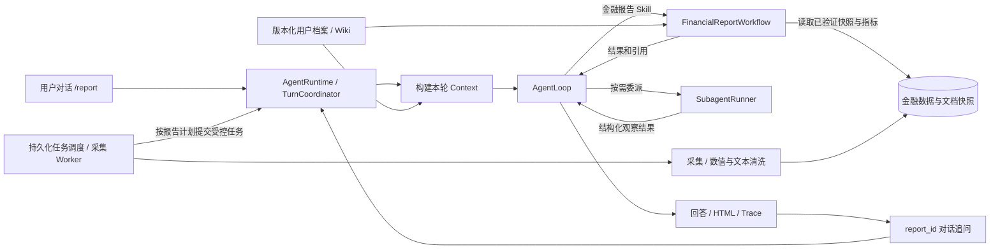

# 金融持续观察接入 Workbench：现状核查与设计

原始设计日期：2026-09-22；实施更新：2026-09-23。

金融扩展已接入现有 Workbench。以下原始现状表和方案保留作为设计依据，不应当作当前功能清单。实施进度见 `financial_observation_todo_cn.md`；交付与真实测试结论见 `acceptance/finance_delivery_cn.md`。

## 实施范围与原方案差异

- 新增第三个工作空间 `finance_observer`，金融档案通过 API 创建，状态为待确认草稿。结构化字段以 SQLite 版本化档案为准，生成 Wiki 展示和检索索引；前端表单可编辑，暂不把随口聊天自动覆盖金融档案。
- `/report` 仍由原 AgentLoop 调用受控 Workflow 工具。在有金融档案的工作空间中进入 `domains/finance/workflow.py`，六阶段为画像/请求、采集、质量校验、确定性指标、中文分析、报告发布。不是另起一套 Runtime。
- 当前实际来源：腾讯日线及新浪备用、统计局中英文发布、Fed/BIS 机构讲话。IMF 实测拒绝访问；FRED、人民银行数值库、券商研报及持仓账户均未接入。来源样本不是完整金融数据库。
- 独立 Worker 持续采集只读公共数据，SQLite 保存调度与快照。默认每60分钟采集，**不自动调用付费模型生成日报**；报告在用户发送 `/report` 时生成。机器关机/进程退出时不声称仍在采集。
- 指数变化、区间内最大回撤、连续上涨与排序用纯函数计算。报告证据快照不可变；普通追问通过受工作空间和会话授权限制的 `finance.report_read` 分页回读。
- Context 只放必要投影和可读取的报告 ID，不把全部日线及文章塞入聊天历史。稳定偏好属于 Wiki/Memory；日线、文章、报告属于金融数据存储，不混作长期记忆。
- 报告分析有 schema、真实引文及语义复核；金融追问有证据前置检查及最多两次事实复核。复核是风险控制，不是数学证明，仍需测试和用户核查。
- UI 增加金融档案表单、采集开关、Worker 状态及来源详情；保持原有两个空间、会话、Trace 和产物入口。

## 1. 结论与产品目标

可以在当前 Workbench 内增加金融持续观察能力，复用对话、工作空间、Wiki、Runtime、Subagent、Trace 和产物展示。建议作为第三个工作空间 `finance_observer`，与同花顺业务观察、个人 Agent 技术调研隔离；它仍属于同一个项目。

具体解决的问题：用户无法每天同时跟踪宏观数据发布、市场指数变化和机构观点，也很难把今天的信息与自己的关注清单、昨天的报告相比较。系统持续获取这些信息，生成有时间口径、有来源、能追问变化原因的观察报告。

推荐范围是日频金融观察与周度复盘。指数涨跌、宏观指标、机构文章是三种不同的数据，不能仅通过更换新闻源完成迁移。当前具备可复用的 Harness 基础，但还不是经过金融场景验证的通用运行平台；跨业务扩展也不等于 AGI。

## 2. 当前代码实际具备什么

| 部分 | 当前证据 | 金融接入时的判断 |
|---|---|---|
| 统一入口 | `app/chat_workbench_service.py:106` 创建 `AgentRuntime`，调用 `run_turn` | 可以继续复用 |
| Runtime 组合与执行 | `harness/agent_runtime.py:193` 组装 Store、Registry、Hooks、Coordinator；`runtime/turn_coordinator.py:213` 管理回合 | 自研 Python Runtime，未使用 Pi SDK 或 LangGraph 作为核心执行器 |
| Skill 契约 | `skills/manifest.py:45` 定义 executor、输入输出 schema、工具/子智能体权限和预算 | 金融执行器可以按相同契约接入 |
| 配置外置 | `runtime/plugin_config.py`、`plugins/tools/registry.json` | 配置已外置；executor 注册和若干业务分支仍在 Runtime 内，尚非完全自动发现的插件系统 |
| Wiki 编辑与检索 | `app/api.py:169` 起提供工作空间、Wiki 读写及搜索接口；`company_wiki/loader.py:303` 保存页面 | 已有 Markdown 与 SQLite facts 索引同步；不等于个人档案自动更新 |
| 资料获取 | `source_connectors/ingestion.py:112` 读取共享配置、并发采集、清洗、缓存、保存快照与来源状态 | 当前是按需资料采集，无完整持续采集调度器 |
| 当前数据源 | `config/sources.json` 共 18 个启用源，主要为技术 RSS/GitHub/arXiv/新闻搜索、网信办及工信部页面 | 不是指数行情或宏观数值数据库；源已配置不等于本次在线抓取成功 |
| 报告执行 | `harness/agent_runtime.py:2998` 将工作流放进 AgentLoop；`:3124` 主要分发到共享新闻/资料报告 | 可复用嵌入方式，金融分析需要自己的执行器和数据契约 |
| Context | `harness/chat_context.py:13` 分配历史、事实、记忆、产物预算 | 有基础预算管理；金融数值还需要结构化查询和完整证据组保护 |
| Memory | `harness/agent_runtime.py:2742` 起识别明确保存要求与长期偏好；Store 持久化 | 可存稳定偏好，不能承担每日行情库职责 |
| 报告追问 | `harness/report_context.py:12` 回读同会话、同工作空间的 `recent_news_report`，最多提取三条 | 必须扩展按类型读取与按 report_id 查询，才能可靠支持金融报告追问 |
| Wiki 纠错 | `company_wiki/updater.py` 有 `CorrectionProposal` 和 FACT 修改 | 有基础提案机制；还需统一版本、冲突检查和写入审计 |

当前 `AgentRuntime` 仍有大量业务代码，例如技术主题、报告类型和特定问法处理。新增金融能力时，应把金融规则放入领域模块，通过执行器和上下文读取器接入，避免继续扩大这些分支。

### A-mythink 可以迁移什么

本次使用一个审查 Subagent 只读检查旧项目，主线程复核了数据质量样本和启动脚本。旧项目是金融采集/计算原型，不是可原样移植的后台服务。

- `A-mythink/market-report/scripts/market-collector.py:125`：已有 AKShare、新浪、yfinance 等数据获取适配，可拆出请求和解析部分，再验证具体接口。
- `scripts/trend-engine.mjs:235`：有 SMA、EMA、RSI、ATR、Bollinger、ROC 等计算；按需要迁移纯函数并用标准样例核对，不必为日常宏观观察一次加入所有技术指标。
- `scripts/holdings-fetcher.py`：读取旧档案后估值，不等于同步券商账户或成交记录。旧个人档案可能过时，本次未导入。
- `run.sh:3` 的 cron 只是外部调度配置提示，后续调用 Python、Node 和 Claude CLI；整段搬入会绕开当前 Runtime 的统一治理，因此只拆数据与计算能力。
- `data/raw-2026-06-08.json:186` 的国债记录日期为 `2021-01-22`；`:150` 的黄金 `change_pct` 为 `4328.2`，而包头仍是 `collection_status=complete`。这证明历史样本存在时效/字段校验缺口，不能据此认定现有数据可靠，也不能据此判断其产生原因。

迁移前增加：字段位置/单位测试、陈旧数据拒绝或显式降级、日期与交易日检查、缺失字段检测、同日重复运行去重。旧报告结论不作为新系统的真实市场证据。

## 3. Wiki 应该如何构建

Wiki 回答“为谁观察、关注什么、怎么输出”。高频变化的数据放入数据层，Wiki 可以展示链接和最新概览。

建议金融档案有以下字段。下面是模板，均不代表已确认的个人事实或持仓。

| 类别 | 建议字段 | 谁维护 |
|---|---|---|
| 身份与目的 | 个人/团队、使用目的、金融知识熟悉程度 | 用户填写或明确表达后保存 |
| 观察范围 | 市场、地区、指数/资产代码、宏观指标、关注议题 | 用户维护；代码校验标识和可用源 |
| 观察周期 | 日报/周报、比较窗口、时区、数据截止时间 | 用户配置；采用明确默认值 |
| 报告偏好 | 中文、篇幅、图表、机构观点是否纳入、来源要求 | 用户维护 |
| 可选资产背景 | 用户主动提供的持仓/敞口及生效日期 | 用户录入或授权的数据导入；缺省未知 |
| 约束 | 只观察不执行交易、排除议题、数据预算 | 用户/应用策略共同限定 |

可以先填写：“个人金融学习与信息跟踪；关注中国宏观、A 股主要指数与机构公开观点；希望每日知道新增变化、不同解释和证据不足之处；未提供持仓。”指数与指标清单是建议选项，不自动作为用户事实写入。

工程设计建议：增加结构化 `ResearchProfile`，字段至少包括 `workspace_id`、`purpose`、`markets`、`watchlist`、`report_preferences`、`constraints`、`version`、`updated_at`。现有 `profile_type=personal` 仅表示主体类型，增加独立 `domain=finance`，避免个人模板默认指向 AI 学习。

研究档案中的结构化字段由一个 ProfileService 维护，Wiki 页面和 SQLite 检索索引都是它的展示/检索结果。补充背景文章仍可作为普通 Wiki 页面维护。避免同一个关注清单在 Memory、Markdown 和数据库中有三个可独立修改的真值。

## 4. “同步更新”要分清三件事

| 更新对象 | 行为 | 不应发生的行为 |
|---|---|---|
| 用户画像 | 明确的“以后关注……”生成结构化 patch，经校验后版本递增、更新 Wiki 展示与索引 | 从市场上涨推断用户风险偏好提高 |
| 外部数据 | Worker 自动抓取、规范化、追加新观测/修订记录，展示最后成功采集时间 | 把抓取时间当成数据发生时间，覆盖旧数据而无版本 |
| 分析历史 | 每份报告保存独立版本、证据快照和当时的画像版本 | 今天刷新数据后，昨天报告的证据悄悄变掉 |

明确的用户更新可以直接执行并返回修改内容；表达含糊或与已有事实冲突时生成待确认提案。新增 `ProfilePatch` 记录 `base_version`、字段变更、依据消息、状态，使用预期版本检查防止并发覆盖。持仓变化与偏好变化分开处理。

这部分可以沿用现有提案思路，但必须补上结构化字段、原子提交、版本历史和审计，不能仅给模型一个任意文件写入工具。

## 5. 数据获取：复用共享源注册，新增金融适配器

同花顺和 Agent 技术调研是两个工作空间，不是两套来源体系。金融扩展仍维护全局来源注册表；工作空间只决定查询参数、指标清单和筛选规则。新提供方加入全局池，身份本身不能扩大工具权限或凭证访问范围。

| 数据类型 | 推荐来源与用途 | 接入方式与限制 |
|---|---|---|
| 中国宏观发布 | 国家统计局数据发布、人民银行统计信息 | 官方页面/表格适配，保留统计期、发布日期、单位和原文 |
| 指数行情 | 先评估旧项目 AKShare 适配器，按具体指数选择提供方 | 取日线和必要历史序列；必须实测接口、覆盖日期与单位，AKShare 不是有 SLA 的自有行情源 |
| 海外宏观 | FRED/ALFRED；有需要再增加 IMF 数据 | FRED API 需要 key；支持时间序列与修订口径，不能把最新版直接用于历史时点回答 |
| 政策与机构观点 | 央行/美联储发布、机构公开研究栏目 | 文本采集可复用 RSS/HTML；机构观点保留机构、作者、日期、预测期限，与已发生事实分列 |
| 新闻线索 | 现有新闻搜索与可用资讯源 | 补充发现；关键数字回到数值记录或原始发布，来源失败时明确披露 |

已核对文档：[统计局数据发布](https://www.stats.gov.cn/sj/zxfb/)、[发布日程](https://www.stats.gov.cn/xxgk/sjfb/fbrcb/)、[人民银行统计入口](https://www.pbc.gov.cn/diaochatongjisi/116219/index.html)、[AKShare 指数接口](https://akshare.akfamily.xyz/data/index/index.html)、[宏观接口](https://akshare.akfamily.xyz/data/macro/macro.html)、[FRED observations](https://fred.stlouisfed.org/docs/api/fred/series_observations.html)、[FRED 修订时点](https://fred.stlouisfed.org/docs/api/fred/realtime_period.html)、[美联储 RSS](https://www.federalreserve.gov/feeds/feeds.htm)、[IMF API](https://data.imf.org/en/Resource-Pages/IMF-API)。这次核对的是接口/入口资料，并未完成各来源在本机的连续采集可用性测试。

先确定必需指标和来源，再做探测：能否获取正文/数值、最新可用时间、历史范围、频率/限流、失败行为和可用权限。探测通过后再启用。不能因网页能打开就认定数据链路可用。

### 清洗应分为文本与数值两条

- 文本：正文抽取、发布时间校验、URL/内容去重、转载溯源、事实与预测分类。可复用现有 `discovery.clean_candidates` 的部分能力。
- 数值：资产代码归一、数值与单位、交易日和时区、复权/价格指数/收益指数口径、缺失与异常检查。宏观指标另含统计期、同比/环比、季调状态和修订版本。
- 多源冲突：同口径可核对，异口径不能直接合并；保留冲突与选择依据。来源失败、没有更新、市场休市是不同状态。
- 确定性计算：涨跌幅、区间变化、利差由代码计算并保存输入记录与公式版本；LLM 解释结果，缺少输入就不能补造数字。

建议数据契约：

| 记录 | 最少需要保留 |
|---|---|
| `SourceDocument` | 来源、URL、标题、发布时间、抓取时间、正文/快照引用、hash、事实/观点类型 |
| `MarketObservation` | 资产标识、提供方、交易日/时区、字段、值、单位、价格口径、采集时间、质量状态 |
| `MacroObservation` | 指标、地区、统计期、值、单位/季调口径、发布时间、修订/可知时间、来源 |
| `ComputedMetric` | 指标名、输入 observation IDs、计算窗口、公式版本、结果和单位 |
| `FinancialReport` | report_id、报告期、as_of、profile_version、snapshot_refs、metric_refs、claim/citation、缺失说明 |

历史时点的证据只使用当时已发布的版本。如果来源无法提供历史版本，应说明无法可靠还原，而不是用当前值补出旧报告。

## 6. 持续采集与 AgentLoop 如何配合

图中金融 Workflow、金融数据层和后台调度为新增设计。采集 Worker 定期更新数据；AgentLoop 按任务读取数据、调用确定性分析工具并组织回答。24 小时持续采集不要求 LLM 24 小时空转。

本地方案建议使用独立单实例调度 Worker，采用 APScheduler 的持久化任务机制和 SQLite，避免每个 Web worker 都启动同一组定时任务。官方文档提供 SQLAlchemyJobStore 的 SQLite 示例，以及 misfire、coalesce、max_instances 等控制；具体依赖在实施时固定版本。[APScheduler 文档](https://apscheduler.readthedocs.io/en/stable/userguide.html)

业务上还需自行实现：采集水位、重试退避、唯一任务键、重复投递去重、失败状态和数据新鲜度。一次调度尝试和一份报告的身份分离；幂等键至少包含工作空间/订阅、报告期、画像版本、数据批次和请求参数。重启不能重复发布同一报告。

建议默认节奏：指数按各市场收盘与提供方延迟更新；宏观数据按发布日程检查；机构文章按限流周期采集；日报按用户时区产出。机器关机期间不会采集，恢复后按策略补取。真正全天运行需要常在线主机。

## 7. 金融报告工作流与追问

保留 `/report` 作为用户入口，增加可校验的 `report_kind`。根据用户明确要求、当前档案的 domain 和可用能力决定进入金融报告还是资料研判；混合意图采用明确输出类型或一次澄清，不能只看到“金融”两个字就切路由。

金融 Workflow 的固定步骤建议如下：

1. 固定本轮请求：观察对象、报告期、截止时间、画像版本、数据新鲜度要求。
2. 读取数据快照；确需刷新时调用有预算的采集任务，失败返回部分数据状态。
3. 校验时间、单位、数值和覆盖范围；生成可核查的指标表。
4. 提取重要变化与机构观点，关联用户关注项。
5. 按需让 analyst 分析、skeptic 质疑归因、verifier 核查数字和引用。
6. 发布前 Gate 检查数字可追溯、时间口径、观点标注、来源覆盖和画像关联。
7. 保存结构化报告与 HTML，将摘要、report_id 和证据引用回填主 Agent 上下文。

Subagent 复用现有委派机制，任务 prompt 按本轮问题生成，工具仍受 manifest 约束。无需给每份金融报告强制跑所有角色；数值校验由程序负责，多角色意见也不能替代可靠数据。

报告内容顺序：报告期与数据截至时间 -> 核心变化 -> 宏观数据表 -> 指数变化 -> 机构观点和分歧 -> 对关注清单的意义 -> 不确定性与下次观察点 -> 来源/数据质量附录。市场变化与某事件同时出现不等于证明因果。

报告状态应区分：资料完整且通过校验、部分数据可用、未找到符合条件的信息、采集失败。空数据说明可以生成诊断产物，但不计为完成一份有效金融报告。

### 基础追问应形成不同的读取路径

| 用户问法 | 正确行为 |
|---|---|
| “刚才沪深300的涨跌怎么算的？” | 按 report_id 读取当时的输入值、窗口、公式和来源 |
| “与昨天的报告相比有什么变化？” | 比较两个指定 report_id，披露数据版本/画像版本差异 |
| “现在的数据更新了吗？” | 新鲜度检查，必要时刷新后生成新的 snapshot/report version |
| “上周那条结论今天还成立吗？” | 先回读旧结论，再用当前证据复核，两套证据分别标时点 |
| “今后加上美债收益率” | 更新关注清单版本，之后的新报告采用新版本 |

新增按 artifact 类型注册的报告证据读取器，支持 `report.search`、`report.read`、`report.compare` 这类受控工具；这些名称是设计建议，当前尚无实现。跨会话按 report_id 读取需先校验工作空间归属，不能允许模型提交任意本地路径。

## 8. Context、Memory 和 Harness 的调整重点

| 信息 | 存放位置 | 进入模型上下文的方式 |
|---|---|---|
| 身份、长期目标、明确偏好 | 版本化档案；其他稳定偏好可进入 Memory | 只注入本次相关字段，并绑定版本 |
| 指数历史、宏观数值 | 数值数据库 | 工具按范围查询，返回有单位与时间的结构化结果 |
| 新闻/机构文章 | 文档快照库 | 按问题检索证据段落，保留引用 |
| 已发布结论 | 版本化 Report Artifact | 回读指定报告，不当成永远正确的事实 |
| 聊天经过 | 会话历史与摘要 | 滑动窗口加摘要；需要精确数值时回源 |

Context 的原子单位应是“数值 + 单位 + 时点 + 来源/record_id”。预算不足时减少指标数量或查询区间，不能只截断掉单位和日期。上周的报告与今天的观测放在不同的上下文槽位，避免旧值冒充最新值。

金融插件可拥有只读资料/指标查询、确定性计算、报告写入权限。画像 patch 走专门服务；外部文章只能作为数据，不能变成扩大工具权限的指令。目前需求没有模型生成任意代码的必要，不需要因此新增代码执行沙箱。

每次运行的 Trace 应能回答：用了哪个档案版本、选择哪些数据、抓取是否成功、数据何时发生、哪些值参与计算、哪个子智能体质疑了什么、Gate 为什么允许/拒绝发布、最终报告是哪一版。Trace 不承担保存全部行情序列的职责，通过 snapshot/observation 引用即可追溯。

## 9. 实施边界与次序

推荐新增领域目录 `src/policy_impact/domains/finance/`，放 schemas、connectors、store、metrics、workflow。它是同一项目的模块。共享的档案版本服务、报告证据读取器注册和任务入口放在现有应用/运行时模块中。

实施顺序按可验收结果推进，基础契约从首次实现就保持一致：

1. 建立金融档案 schema/表单模板，并探测一组明确的指数、宏观和机构来源。
2. 跑通“真实数据 -> 清洗 -> 数值校验 -> 入库 -> 查询”，保留原始快照。
3. 接入 FinancialReportWorkflow 与 HTML，经过现有 Runtime、ToolGateway、Trace。
4. 跑通报告引用回读、跨日对比、实时刷新区分与画像变更。
5. 接入持久化调度，测试重启、断源、重复投递与补取。

通用层原则：新业务不需要修改 TurnCoordinator 的生命周期或 AgentLoop 的 action 语义；可以增加执行器注册、上下文提供器、工具权限和领域 schema。如果每增加一个领域都必须改大量主循环分支，说明抽象边界仍未完成。

## 10. 验收问题与标准

| 场景/用户 query | 必须看见的证据 |
|---|---|
| “我关注中国宏观和A股指数，只要日报，不做个股建议。请保存。” | 结构化档案变更和版本；未提供的持仓保持未知 |
| “/report 按我的关注清单生成最近一周金融观察报告。” | 数值表、正文来源、Wiki 关联、报告期、HTML 与报告引用 |
| “只看指数表现，不要技术新闻。” | 数据范围正确，没有 Agent 技术新闻混入 |
| “这个涨幅是多少，怎么算出来的？” | 可复算输入、日期、单位和公式 |
| “这两家机构为什么观点相反？” | 两边各自的时间、证据、假设，未将预测当成事实 |
| “昨天和今天有什么变化？” | 两份报告/快照的差异，非重复摘要 |
| “上个月的结论当时依据什么？” | 当时可知版本；无法恢复则说明限制 |
| “以后加上另一市场的指数。” | 画像版本变化；旧报告仍关联旧版本 |
| 切回 Agent 技术调研或同花顺 | Wiki、Memory、聊天与报告归属不串工作空间 |
| 周末、缺数、断源、指标修订 | 区分状态，缺失不补零，修订不悄悄覆盖 |
| 重启采集进程、重复触发日报 | 不重复发布；失败可定位和恢复 |
| 长对话后追问某个报告数字 | 按引用回读，不能仅凭有损聊天摘要回答 |

合格报告必须实际回答关注清单的问题，有可复算数字、有可核查来源、有清楚的数据截至时间。能生成 HTML、Trace 很长或者单元测试通过，都不能单独证明金融报告质量。

## 11. 本次核查边界

- 已阅读现有 Runtime、Skill、采集、Wiki 更新、Memory、报告上下文等相关实现。
- 已运行 `py -3 -m pytest tests/test_executor_registry.py tests/test_turn_coordinator.py tests/test_report_context.py tests/test_workspace_profile_api.py tests/test_plugin_config_loading.py -q`：196 passed，44 条现有 Pydantic 弃用警告。
- 这些是现有接口与边界的回归，不是金融功能端到端测试，也不是吞吐/延迟基准。
- 本轮访问 `http://127.0.0.1:8503/companies` 未能连接，因此没有把历史浏览器页面当作当前运行证明。
- 本次输出设计文档，未写入真实金融档案、未迁移旧持仓、未启用定时任务、未声称金融功能已上线。
