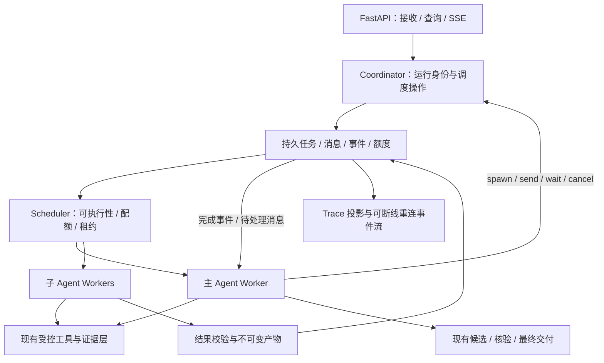

# Harness 2.0：可控、可恢复的金融多 Agent 研究方案

状态：**调研依据与总体方案参考**。具体第一阶段实现范围已收敛到[变更 011](../changes/011-harness-v2-agent-scheduling.md)。整理日期 2026-10-18，源码快照取自 2026-10-17。本文不修改现行[架构](../architecture.md)、[接口](../finance_agent_interface_contracts.md)或 1.0 验收要求，也不等于其中已有的 analyst/产物 v2 接口。

2026-10-18 已形成 Harness 2.0 第一阶段候选：**Persistent Agent Scheduling Core**，但用户要求先完成多层设计和验证方案确认，当前尚未实现。本文件保留 Codex 调研、取舍和长期候选；候选边界、状态语义与测试要求以变更 011 为准。这里的同步适配器不能被称为完整异步并行调度，也不为采用 Codex 机制反向编造 1.0 缺陷。

目的：在保留金融研究能力与主 Agent 自主判断的前提下，学习并实现可靠的任务调度、子 Agent 控制、上下文交接和恢复，而不是增加一批固定金融工作流。实现前先确认总体方案，再细化独立执行契约、表结构、失败语义与验收。

## 1. 调研证据与不能声称的事

### 1.1 来源核验

用户提供的[微信公众号文章](https://mp.weixin.qq.com/s/_EgLSCc4dj0gt-09Uaw7eA)本次返回微信校验页，**未取得正文，不能逐条认证其中的说法**。若之后提供正文或截图，再补文章主张与一手资料的逐项对照；以下研究不依赖猜测该文章内容。

本次实际读取 OpenAI 官方 Subagents 文档及 `openai/codex` 官方开源源码。文档入口发生重定向，以实际取得的官方内容为准。源码固定在提交 `ce0323f2f2d3b25e82806cd555237da3db4e1897`，提交时间 2026-10-17 04:02:21 UTC；这是研究快照，不代表锁定为本项目依赖或验证其所有功能。

| 编号 | 实际查阅的一手来源 | 可支持的结论 |
| --- | --- | --- |
| S1 | [OpenAI Subagents 文档](https://developers.openai.com/codex/multi-agent)；[实际 Markdown 页面](https://learn.chatgpt.com/docs/agent-configuration/subagents.md) | 独立子线程、并行委派、专门指令、收集结果及权限继承；多 Agent 也会增加用量与协调成本 |
| S2 | [spawn handler](https://github.com/openai/codex/blob/ce0323f2f2d3b25e82806cd555237da3db4e1897/codex-rs/core/src/tools/handlers/multi_agents/spawn.rs) | 解析任务、选择角色/配置、检查深度、创建父子线程并返回 agent ID；存在显式 `fork_context` 分支 |
| S3 | [send_input handler](https://github.com/openai/codex/blob/ce0323f2f2d3b25e82806cd555237da3db4e1897/codex-rs/core/src/tools/handlers/multi_agents/send_input.rs) | 可以向已有 Agent 发送输入，支持显式中断选项，返回提交标识；发送不是等待最终分析完成 |
| S4 | [wait handler](https://github.com/openai/codex/blob/ce0323f2f2d3b25e82806cd555237da3db4e1897/codex-rs/core/src/tools/handlers/multi_agents/wait.rs) | 订阅状态并有界等待；任一目标出现终态即可返回，不是每次 wait 都等全部完成；超时返回不等于杀死子任务 |
| S5 | [close handler](https://github.com/openai/codex/blob/ce0323f2f2d3b25e82806cd555237da3db4e1897/codex-rs/core/src/tools/handlers/multi_agents/close_agent.rs)、[resume handler](https://github.com/openai/codex/blob/ce0323f2f2d3b25e82806cd555237da3db4e1897/codex-rs/core/src/tools/handlers/multi_agents/resume_agent.rs) | 关闭与恢复是单独控制操作，有前状态、错误与配置校验，不等于重新发一个无身份关联的 Prompt |
| S6 | [AgentControl 接口](https://github.com/openai/codex/blob/ce0323f2f2d3b25e82806cd555237da3db4e1897/codex-rs/core/src/agent/api.rs) | 把协调与具体运行位置分开；输入接收、邮箱、状态、预算及结果通知分别建模。该接口明确接收不等于模型已读，local 结果通知仍有 best-effort 边界 |
| S7 | [registry](https://github.com/openai/codex/blob/ce0323f2f2d3b25e82806cd555237da3db4e1897/codex-rs/core/src/agent/registry.rs)、[child_config](https://github.com/openai/codex/blob/ce0323f2f2d3b25e82806cd555237da3db4e1897/codex-rs/core/src/agent/child_config.rs) | 线程配额预留、身份注册、深度限制及父级有效配置继承，与角色指令是不同机制 |
| S8 | [completion](https://github.com/openai/codex/blob/ce0323f2f2d3b25e82806cd555237da3db4e1897/codex-rs/core/src/agent/control/completion.rs)、[mailbox](https://github.com/openai/codex/blob/ce0323f2f2d3b25e82806cd555237da3db4e1897/codex-rs/core/src/agent/control/mailbox.rs) | 子任务终态向父节点路由；存在不启动新一轮的排队消息。所读 local mailbox 是内存结构，不能冒称分布式持久邮箱 |
| S9 | [父子关系迁移](https://github.com/openai/codex/blob/ce0323f2f2d3b25e82806cd555237da3db4e1897/codex-rs/state/migrations/0021_thread_spawn_edges.sql)、[关系读写](https://github.com/openai/codex/blob/ce0323f2f2d3b25e82806cd555237da3db4e1897/codex-rs/state/src/runtime/threads.rs) | SQLite 中保存线程父子边及状态；持久身份和活跃运行对象不是同一个东西 |
| S10 | [SQLite 队列实现](https://github.com/openai/codex/blob/ce0323f2f2d3b25e82806cd555237da3db4e1897/codex-rs/state/src/runtime/queued_items.rs)、[队列迁移](https://github.com/openai/codex/blob/ce0323f2f2d3b25e82806cd555237da3db4e1897/codex-rs/state/queue_migrations/0001_queued_items.sql) | 存在线程范围的持久用户输入队列；**不是已证明通用多 worker 子任务调度、租约或分布式恰好一次执行** |
| S11 | [compact.rs](https://github.com/openai/codex/blob/ce0323f2f2d3b25e82806cd555237da3db4e1897/codex-rs/core/src/compact.rs) | 压缩有独立过程、上下文重建、完成信号和持久历史替换；不是给所有模型套一个已知最优百分比 |

这些来源证明公开 Codex 的可观察机制，不公开证明 ChatGPT 全部服务端架构、商业服务数据库或模型隐藏推理。源码里自己的 `MultiAgentVersion::V1/V2` 也不是本项目 1.0/2.0 的版本定义。本文未构建/运行 Codex，也未用它证明本项目金融效果。

### 1.2 最值得借鉴的部分

核心不是“给分析师/反对者/总结者各写一份 Prompt”，而是让模型拥有可控制的委派能力，底下有真实任务身份、独立上下文、状态订阅、输入递送、结果交接与资源边界；这一分层可由 S2-S8 查证。**模型决定研究；可靠调度层应让被接受的操作有真实状态且不会无声丢失。** 后一句是本项目拟实现并测试的目标，不是上述 Codex local 实现已经给出的持久化保证。

不照搬编码专用能力：worktree、文件编辑冲突、代码 diff 不是金融阅读必需功能。对金融更重要的是作者、时间、口径、源版本与证据继承。也不把 Codex 某个本地 best-effort 实现包装成自己的可靠消息保证；后者需另行设计与故障测试。

## 2. 与当前系统的差距

完整现状见[1.0 总览](../system-overview-v1.md)，这里仅列此次改造边界。

| 方面 | 当前 1.0 | 建议的 2.0 方向 |
| --- | --- | --- |
| 委派 | 一次同步调用，父循环等子任务返回 | 创建返回句柄；父任务可做独立工作，也可等待事件 |
| 追问 | 一次任务/结果为主 | 复用同一子线程发具体补充任务；区分消息接收与实际处理 |
| 生命周期 | 身份、Trace 与运行内产物已有；不承诺持久调度 | 分开建模任务、Agent 线程、执行尝试、消息、检查点与结果 |
| 并发 | HTTP 进程内线程池，不等于子任务调度 | 统一并发额度与公平调度；父任务等待时释放执行资源 |
| 恢复 | 可恢复材料和候选文件 | 恢复时还知道目标、授权、待处理消息、已完成调用与未决子任务 |
| 资源 | 进程内上下文预算对象/物理请求总账 | 多 worker 共用原子额度预留与核销，父子不能分别花同一份余额 |
| 上下文 | 本轮 70%/60% 换出，跨轮仍有最近 8 条等小预算编译 | 明确统一有效输入容量及优先级，再按真实压力组织可恢复上下文 |
| 证明 | 三类真实问题 6 次完整交付，严格冻结 4/6 | 同基线比较，并专门验证并发、消息、取消、恢复与委派金融质量 |

**推荐保留现有 AgentLoop、来源工具、研究结果契约和审核/交付能力，新增协调与持久化边界。** 不建议为了“像 Codex”整体换框架，也不把现有能力全部重写。

## 3. 总体方案：动态研究 + 可恢复任务服务



这是运行架构图，不是固定金融流程。主 Agent 不必派任务；能自己完成的直接完成。委派的单位可以是一篇文章、一组相关文章、一个比较维度、一个待核查命题或一份候选稿，不按作者数量自动创建角色。

推荐第一阶段使用**主 Agent 统筹的一层子任务树**；子任务提出后续需要，由主 Agent 决定是否派新任务。未来若要子任务再次委派，单独开放有额度与深度限制的能力，不默认递归。此为本项目建议，不冒称 Codex 只允许一层。

## 4. 先把几个对象分开

| 对象 | 含义 | 为什么要分开 |
| --- | --- | --- |
| Session | 用户对话及持久消息 | 一段对话可有多轮研究 |
| Root Run | 本次用户请求的预算、研究时钟与交付责任 | 多个孩子共享同一个根资源边界 |
| Agent Thread | 某个执行者的独立上下文与授权身份，是逻辑对话单元，不等于一个操作系统线程/进程 | 一次补充分析可复用线程，但不等于复用旧任务成功状态 |
| Task | 有目标、材料和完成期待的逻辑工作 | “读这篇”和“补查这个条件”可以是同线程不同任务 |
| Attempt | 某任务的一次物理执行 | 网络/进程失败重试不能伪装成只执行过一次 |
| Message / Event | 待处理输入 / 已发生事实 | 接收指令不是读懂指令；完成通知不是父任务已采用 |
| Checkpoint / Result | 可继续执行的状态 / 已产出的分析 | 保存一段分析正文不等于保存了继续执行所需的全部状态 |

现有 `run_id/task_id/span_id/EvidenceRef` 保留或显式映射，不让模型自行填写执行状态、租约、源版本或真实调用 ID。恢复保持逻辑任务身份，新执行使用新 attempt；不会把旧调用与新返回按顺序拼在一起。

## 5. 给主 Agent 的操作能力草案

以下是语义提议，**不是已经注册的工具或最终字段 Schema**。确认后单独写接口文档，仍通过现有公开 JSON action 调用，不要求切换供应商原生 Function Calling。

| 操作 | 关键语义 | 失败/边界 |
| --- | --- | --- |
| `agent.spawn` | 提交现有研究任务结构与授权材料，返回任务/线程 ID 和接收状态；不等完成 | 先校验/持久接收再回执；相同操作幂等键不重复创建；排队不写成运行 |
| `agent.send` | 给已知子线程追加具体输入；默认在安全边界处理；可产生新的补充任务 | `accepted` 不表示已进入模型输入。打断须显式选择；新指令不静默改写已完成结果或扩大授权 |
| `agent.wait` | 订阅指定任务的状态变化，可先收任一完成结果，再决定是否继续等 | 等待超时仅是此次等待结束；不终止孩子，不轮询消耗模型请求；父 worker 在可恢复检查点释放 |
| `agent.status` | 查询可见子任务状态、版本、结果引用与真实错误 | 不能查询其他根运行；查询本身不触发重试或模型调用 |
| `agent.cancel` | 取消任务及指定范围的后代，停止新外部调用；回执区分请求取消与已停止 | 已发送的模型请求未必可撤回；迟到结果保留审计但不能自动发布 |
| `agent.close` | 释放不再需要的子线程执行资源，保留产物与历史 | 与任务成功分开；未停下的任务须先走取消确认，不假报资源已释放 |
| `agent.resume` | 从已提交检查点，在重新确认权限/版本/剩余额度后继续 | 不默认复活已取消任务、延长截止时间或换模型；恢复失败保留原结果和具体缺口 |

同时保留父任务的结果处置 `use/qualify/exclude/follow_up`。通知可以先送轻量状态和结果引用，但**完整分析必须保存且按授权可展开**，输入适配时可以直接交接全文；不一律把高密度金融观点压成几句话。

### 一次委派真正包含什么

沿用当前 `finance.research_task.v1` 的原问题、单项任务、材料、结果类型和完成期待，按需加 focus/user_requirements；执行层另外绑定身份、权限、预算、Prompt/Skill/模型配置版本与恢复点。阅读、综合仍返回当前 `finance.research_result.v1` 的自由正文和来源外层。新增调度信封不把它改回 claims-only，也不把 verifier/skeptic 的类型化结果强行转成同一种正文。

子 Prompt 负责：完成这项任务、仅使用授权能力、区分作者观点与自身推断、保留条件/局限、给可回源结果、有具体缺口就报告。不要为每种金融提问新增一段硬编码业务规则。权限在工具层执行，不能只写“你是只读分析师”。

## 6. 状态、并发和可靠性怎么设计

### 6.1 三套状态不能合并

拟议任务状态：`queued -> running -> waiting -> running -> succeeded/failed/cancelled/timed_out`；也可直接从 running 进入终态。waiting 代表已保存继续执行点、等待已登记事件，不占用长期阻塞 worker。失败任务若获准重试，记录调度决定并创建新 attempt，再进入 queued；不是把原失败记录抹掉。

线程状态描述执行资源是否开放/装载，不表示研究正确。研究覆盖、审核执行、主张支持程度与最终交付继续使用现有独立维度。成功返回“本篇没有相关内容”可以是任务执行成功；带未决争议的完整答案可以已交付；两者都不表示事实已验证。

### 6.2 必须处理的边界

| 问题 | 拟议处理 |
| --- | --- |
| 两个 worker 同时领取 | 数据库条件更新/事务领取任务，设置 lease 与单调递增的执行代次；旧 worker 丢失所有权后不能提交最终状态 |
| worker 崩溃 | 心跳停止、租约过期后进行协调；有有效检查点且仍有预算才恢复，否则如实终止并交回已有安全结果 |
| 完成了但通知丢失 | 任务状态、结果索引和待投递事件在同一数据库事务提交；通知可重复，父任务按事件 ID 去重。醒来后也查询持久状态补齐 |
| 等待时恰好完成 | 先记录等待集合与读取游标，再查现状/订阅变化；恢复时补读游标后的事件，避免只听下一条通知 |
| 重复 spawn / 重试 | 操作 ID/幂等键作用于同一调用，不按“文章相同”去重所有研究。相同文章不同问题仍可分析 |
| 供应方返回与本地提交之间崩溃 | 记录结果未知的物理请求；无供应方幂等保障时不能承诺模型仅执行/收费一次。重试有新 attempt，最终接收和交付去重 |
| 取消与完成竞态 | 以任务版本和事务提交顺序裁决，保留双方事件；取消之后的迟到返回不自动重新激活任务 |
| 关闭/终稿后孩子仍运行 | 根运行进入收尾时先阻止新增子任务，明确采用/取消/等待未决任务；晚到产物记录但不偷偷改已发布答案 |
| 子任务占满所有容量 | 全局/根运行/线程分别限并发，保留主任务继续与交付资源；等待释放 worker，不能用父阻塞等待占满线程池 |
| 孩子并发花预算 | 请求发出前原子预留根额度，结束后核销实际使用；重试、审核及压缩也记账。来源取材与交付预留分开 |

租约代次用于拒绝旧执行者写入，不等于已经中止远端请求。等待时限、子任务时限、整轮截止与 HTTP 连接时限分别处理；当前 60/20 分钟及收尾预留不在本草案中被悄悄更改。

## 7. 数据库与队列：逻辑模型，不直接建表

建议保留现有会话、运行、消息与 Trace 表；新增执行实体，不把 `agent_steps` 的显示序号兼任队列或分布式锁。下面是**待细化的逻辑表族**，表名和合并方式尚未定稿，不是 DDL：

| 表族草名 | 存什么 | 关键约束 |
| --- | --- | --- |
| `harness_tasks` | root/parent/task、目标快照、线程归属、状态、版本、截止时间、结果引用 | 根权限隔离；操作幂等唯一键；状态迁移条件更新 |
| `harness_task_dependencies` | 同根任务的等待/依赖边 | 区分父子身份与先后依赖，拒绝循环和跨根依赖 |
| `harness_agent_threads` | Agent 身份、父线程、角色版本、模型配置、授权/上下文引用、开放状态 | 同线程最多一个活跃执行者；不把关闭等同删除历史 |
| `harness_attempts` | task、attempt、worker、lease、执行代次、开始/心跳/结束、错误 | 单任务活跃所有权；旧代次不可提交；保留全部尝试 |
| `harness_messages` | 发件/收件身份、顺序、任务关联、正文引用、接收与实际输入收据 | 消息去重与顺序；只记录可证明的处理阶段，不伪造“模型理解” |
| `harness_events` / 投递记录 | 状态变化、来源关联、递增游标、父节点待投递事件 | 事件随状态同事务提交；投递至少一次、接收幂等；SSE 只是投影 |
| `harness_checkpoints` | 循环状态、消息/事件游标、上下文清单、待调用/已完成调用、源版本 | 不可变、可校验、明确提交标志；恢复前检查权限与依赖 |
| `harness_result_refs` | 当前研究产物或审核结果的不可变引用、checksum、来源/任务、接收/处置 | 成功保存才发布 recoverable ID；保留失败和部分结果的真实状态 |
| `harness_budget_reservations` | 根额度、请求预留、实际请求/用量、未知结果与核销 | 并发原子预留，不因失败/重启自动退回可能已花掉的额度 |

大正文是否继续存在不可变文件或入库，需在接口阶段确认。若沿用文件：先写并校验不可变文件，再在数据库提交可见引用；崩溃后协调孤立文件/未提交引用。不宣称文件系统和 SQLite 是一个原子事务。来源与授权快照的存储可附属于检查点/线程，但不能只有一个未经校验的任意路径。

### 技术路线的三个选择

| 路线 | 适用与优点 | 局限与本项目建议 |
| --- | --- | --- |
| A. 仅进程内异步调度 | 可先学习 spawn/wait/send 和独立上下文，改动较少 | 不能承诺重启恢复；若目标包含可靠恢复，不建议将它作为最终 2.0 交付 |
| B. 单机持久任务服务，沿用 SQLite | 保持当前技术栈；把状态、消息、领取和恢复做完整；便于个人部署和学习 | 需短事务、写竞争/取消/恢复测试及明确单机范围。**本项目当前个人使用的推荐起点，待用户选择** |
| C. PostgreSQL 等集中数据库 + 独立 workers，必要时加消息基础设施 | 后续多实例部署的候选；任务和状态模型可沿用 | 部署、迁移、连接及运维成本增加；没有并发/服务目标前不直接选定，更不声称加 Redis 即可商用 |

无论选哪条，队列只提供可靠调度的一部分，金融正确性仍依赖模型、任务边界、原文和证据。若要多机/多用户，应另定认证、租户隔离、配额、数据保留/备份和服务指标，不把个人版成功率推广过去。

## 8. 上下文：先统一边界，再研究复杂压缩

这里先定职责，具体算法仍需确认，不提前重选 A-E。

1. **子任务新上下文**：默认原问题 + 被派目标 + 授权材料/必要理解 + Skills/工具契约 + 预算。不要默认复制全部父对话；完整文章或理解适配时可直接交接。需要上下文 fork 时显式选择并检查可见内容，不能连父权限也全部复制。
2. **同一 Agent 的恢复**：保存当前任务/计划、已纳入与未处理材料、原文和理解引用、已完成工具调用/结果、消息游标、候选及审核未决项。重启恢复这些公开执行状态，不保存/伪造隐藏思考，也不承诺续接远端尚未结束的流。
3. **跨轮用户历史**：当前最近 8 条、1600/700 等分项预算与“真实压力才缩减”的方向需要专门统一。建议先确认有效容量内保留必要原始历史及最新目标，超容量才创建可回源工作视图；不是立即把所有历史、Trace、原文无选择地塞满 1M。
4. **容量与压力**：保留用户最高 1M、较小配置优先、实际输出和安全预留的边界。70%/60% 是当前工程配置，不是金融质量最优值；通过实际输入/用量校准，不能只看字符数。
5. **选择由 Agent，保真由 Runtime**：Agent 决定相关材料和工作视图；Runtime 保证精确来源、源版本、授权恢复、未决事项与已提交候选不丢。全文回读针对具体缺口，不为了证明认真而重复所有原文。

若主上下文过大，轻量通知不代表只保留轻量结果：完整理解仍能展开；工作视图需保留改变判断的条件、反例、时间差异与缺口。任何跨运行复用还需单独定义缓存新鲜度和权限，不因存在产物 ID 自动开启。

## 9. 放进真实金融问题会怎么工作

示例：“比较 TT 和培风客最近三个月对黄金的共识、分歧和变化，解释各自依据。”这只是展示可行路径，不是新增专门多作者规则。

```text
主 Agent 理解问题并建计划
  -> 发现两位作者在正确时间窗内的材料，选择有用范围
  -> 若独立分析值得委派：为两个有边界任务绑定材料和完成期待
     创建后立即取得句柄，不等第一个结束再创建第二个
  -> 孩子在各自上下文中读文、解释推理、保留条件/证据/缺口
     主 Agent 同时可以整理比较维度或做其他独立工作
  -> 任一孩子完成：校验来源并交接完整结果，主 Agent 接收/限定/排除
     发现“短期与长期是否混淆”等具体缺口，可向原线程追加补充任务
  -> 主 Agent 自行或另派综合，保留日期、口径及不可比的部分
  -> 对重要主张选择核查；需要独立公开资料时才授权核查任务
  -> 保留作者观点与反证，保存完整候选，完成或披露未完成审核
  -> 关闭/取消不再需要的任务，交付安全分析并记录状态
```

若仅深挖一篇短文，主 Agent 直接阅读全文即可，也可以委派一个任务；不启动两个角色来凑多 Agent。若概括一位作者，仍按证据覆盖选择代表性材料，除非用户明确要求全部。若一位作者确实没相关观点，如实报告缺失，不制造对立；若一个孩子失败，保留另一个有效结果和失败原因，不把比较完整性标成成功。

孩子们重复同一信息源、彼此同意或采用不同角色，均不构成独立事实验证。对金融的实质优化目标是减少观点/条件遗漏、时间与归因混淆，提供更有解释力的综合；并行速度只是另一项指标。

## 10. 分阶段实现与如何证明有效

| 阶段 | 先确认的文本 / 接口 | 实现与验证边界 |
| --- | --- | --- |
| 0. 冻结与裁决 | 本方案选择；现有基线限制；跨轮上下文冲突的处理方向 | 保留 r009-01 原始成绩和代码/语料/模型/预算标识，不称 1.0 全能力已通过 |
| 1. 可控子线程 | Task/Thread/Attempt、spawn/send/wait/cancel/close/resume、结果导入、权限和模型固定 | 新旧路径可选择且可回退；使用现有分析结果与 JSON 契约；状态与故障夹具先通过 |
| 2. 持久化与恢复 | 表/索引、事务、租约代次、检查点、消息收据、事件投递与去重、共享预算 | 注入领取/提交/通知/取消/重启故障，验证无无声丢失、重复交付或权限扩大 |
| 3. 上下文统一 | 跨轮、本轮与子任务编译；容量/工作视图/恢复规则 | 无压力不人为过早缩减；真实压力下能恢复关键条件、目标与证据；不以字数证明无损 |
| 4. 业务对照 | 固定模型/profile、语料、研究时钟、资源预算及次数 | 同三类基线对照，并覆盖真实阅读/综合委派及失败/恢复；再扩展其余既有 30 题，不改题目以求通过 |

阶段按集成风险拆分，不表示只做一个无法验收的演示版。阶段 1 可以先通过夹具证明协调契约，但路线 B 的“持久接收/可恢复”必须等阶段 2 接通后验收，不能把进程内回执标成 durable。每阶段分别记录设计、代码、离线证明和真实证明；技术恢复通过后才能做下一层质量推断。

建议验证矩阵（还不是用户批准的新付费批次）：

| 层 | 必须观察的证据 |
| --- | --- |
| 状态与接口 | 同一任务身份、多次 attempt；输入接收/进入模型/结果/父处置可区分；未知/越权 ID 拒绝；wait 超时不取消 |
| 并发与故障 | 两 worker 争领、父等待释放资源、通知重复/丢失、进程退出、租约过期、取消与完成同时发生、迟到结果和额度竞争 |
| 上下文 | 原文/完整理解/视图区分；恢复前后目标、条件、未决子任务与引用不混淆；跨轮已有细节不因固定小预算无声丢失 |
| 业务 | 沿用内容/证据/Trace 三栏人工标准；至少有真实委派阅读与综合，不把一个 Agent 自读成功当成多 Agent 验收。能力专测可明确提出委派要求，普通 Query 仍自主选择，不能为跑通统计强制修改金融流程 |
| 对照与重复 | 同输入和预算重复多次，分别报完整交付、严格通过、委派/恢复成功、时延和真实请求/用量；不将不同模型结果拼成同一个成功率 |
| 产品价值 | 是否解释作者推理、保留相反条件、回答用户所问；多 Agent 版本若更慢、更贵且遗漏更多，应记录退化而非因结构先进判通过 |

并发量、重复次数、硬错误门槛及可接受时延尚需用户共同确认。6 次真实交付不是商用成功率估计，离线 1568 项也不是它的替代。发布升级时仍需明确回退条件，不以无限重跑直到成功代替验收。

## 11. 需要用户先裁决的点

| 决策 | 当前推荐 | 其他选择 / 尚未定稿 |
| --- | --- | --- |
| 总体形态 | 自研 AgentControl 式协调层 + 现有执行循环与金融插件；主 Agent 自主委派，一层子任务优先 | 更广递归或替换框架需单独选择，不默认采用 |
| 持久化目标 | 路线 B：先做单机可恢复任务服务，沿用 SQLite 的候选方向 | 若近期就多机多人，改选路线 C；具体表结构、队列实现与并发值尚待设计 |
| 上下文 | 先统一跨轮/运行内/子任务的容量与恢复规则，再增加复杂压缩 | 保留旧历史小预算仅作显式兼容选择，不能同时宣传全部到 70% 才压缩 |

确认顺序建议：先审本方案的职责、生命周期与适用场景，再定后端/状态/接口和上下文的详细决策，最后实施。**本轮只新增总览和草案，不改运行代码、不建表、不启动付费测试。**
