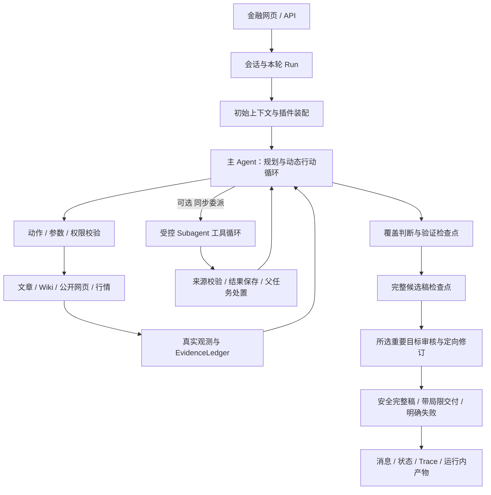

# 1.0 系统总览：策略、实现与验证地图

整理日期：2026-10-18。本文是现状总览和导航，不是另一套行为规范。设计权威仍是[设计入口](README.md)中的产品、架构、接口和验收文档；本文不能把未确认的设计或未验证的能力变成已完成事项。

当前阶段：先按[共同复核清单](README.md#4-当前共同复核-10再冻结版本)讲清 1.0、核对代码与验证证据，收口后保存 Git 基线。Harness 2.0 暂停实施；下文的边界说明不是自动获得批准的改造清单。

## 1. 当前系统是什么

当前产品是个人日常使用的金融研究 Agent：理解金融短文中的观点与推理，比较不同作者或时间阶段，并按需要使用公开信息核查。技术是 **Python + FastAPI + 自研 Harness + SQLite + 原生网页**，不是安装了 Codex、MemGPT 或某个多 Agent 框架。

主 Agent 决定研究方法；Runtime 管工具契约、权限、真实证据、资源边界与可追溯性。A-E 是可以组合的研究能力，不是每个问题都必须走完的五段流水线。具体来源与适配限制见[研究选型](research-decisions.md)。

这里的“1.0”是产品基线；已有的 `analyst@2.0.0`、`finance.research_artifact.v2` 是局部接口版本，**不代表 Harness 2.0 已经实现**。



图中的工具和委派是选择，不是固定顺序；取材、分析、验证可以根据新信息返回前面的阶段。只有主任务负责最终交付。

## 2. 一轮研究如何运行

| 阶段 | 当前主要行为 | 回查入口 |
| --- | --- | --- |
| 接收 | 绑定会话、用户消息、本轮运行、模型配置与研究时钟；准备可见上下文 | `ChatWorkbenchService`、`AgentRuntime._build_context` |
| 装配 | 根据 manifest 加载 System Prompt、Skills、工具描述和子角色注册 | 本文第 4 节 |
| 规划 | 首次取材前创建 `research.plan`，保持用户要求、范围、完成条件与验证目标 | [架构第 3 节](architecture.md#3-规划选材与停止) |
| 动态行动 | 模型返回公开 JSON action；Runtime 校验后执行工具、同步委派或处理候选终稿 | `AgentLoop.run`、`FinanceResearchGateway` |
| 阅读与综合 | 自读或委派；保留各文章身份、日期、范围与证据；深读全文适配时整体分析 | [架构第 4-5 节](architecture.md#4-单篇文章与文章集合)、[接口第 8 节](finance_agent_interface_contracts.md#8-versioned-research-integration-contract) |
| 覆盖与验证 | 主 Agent 记录依据、反例、缺口及是否继续；选重要目标核查，不逐句强审 | `research.coverage`、`research.checkpoint`、[架构第 6 节](architecture.md#6-验证目标结果与修订) |
| 候选与审核 | 审核前保存完整候选，审核绑定候选版本；可增量补证、修订或保留有限结论 | [变更 008](changes/008-review-convergence-and-draft-delivery.md) |
| 交付 | 普通争议或审核失败尽量保留安全完整分析；来源伪造、越权等只限制受影响内容；交付状态与研究/审核状态分开 | [架构第 7 节](architecture.md#7-结构恢复审核失败与交付)、[接口第 5 节](finance_agent_interface_contracts.md) |

这描述外部可观察的执行与证据关系，不要求保存或展示模型隐藏思考。工具调用多、输出快或慢都不能独立证明分析深度。

## 3. 各项策略放在哪里

| 策略 | 当前设计与实现边界 | 详细设计 / 代码 |
| --- | --- | --- |
| 目标保持与规划 | 每轮先计划；研究目标逐项完成或有理由阻塞；真正交付后才更新 delivery | [架构第 3 节](architecture.md#3-规划选材与停止)；[research_plan.py](../src/policy_impact/domains/finance/research_plan.py) |
| 来源定位与权限 | 从 Wiki/目录地图发现来源，也允许按已授权 ID 直接读；路径、角色工具与材料授权不能被 Prompt 绕过 | [架构第 1-3 节](architecture.md)；[research_gateway.py](../src/policy_impact/domains/finance/research_gateway.py)、[tool_gateway.py](../src/policy_impact/harness/tool_gateway.py) |
| 单篇理解 A | 围绕任务的连贯理解为主，卡片/claims 可选；全文优先，不以旧 100 行分段调用冒充新读法 | [接口 3.1 / 第 8 节](finance_agent_interface_contracts.md#31-target-single-article-handoff)；[research_execution.py](../src/policy_impact/domains/finance/research_execution.py) |
| 多篇关系 B | 比较可比议题、时间与条件；允许相似、相反、变化、互补或无可支持关系；共识不等于事实认证 | [架构第 5 节](architecture.md#5-跨文章分析)；[变更 004](changes/004-versioned-research-implementation.md) |
| 动态流程 C | ReAct 式主循环选择行动、补证、委派与停止，不为每个金融问题单写 DAG | [架构第 2 节](architecture.md#2-总体职责链与分支)；[agent_loop.py](../src/policy_impact/harness/agent_loop.py) |
| 停止取材 | 普通概括可代表性抽样并披露；明确全部/逐篇则保留该完成要求。停止由 Agent 按证据覆盖判断，Runtime 防重复并预留收尾资源 | [接口 2.2-2.3](finance_agent_interface_contracts.md#22-article-collection-semantics)；[research_coverage.md](../plugins/skills/finance/research_coverage.md) |
| 类型化验证 D | 区分作者观点、事实、预测、因果、模型推断与个人背景；按目标核对、保留原观点与反向证据 | [架构第 6-7 节](architecture.md#6-验证目标结果与修订)；[answer_audit.py](../src/policy_impact/domains/finance/answer_audit.py) |
| 子任务职责 | analyst / verifier / skeptic 等由主 Agent 按需选择，权限取父任务与角色工具的交集；当前委派仍同步 | [架构第 8 节](architecture.md#8-subagent-与上下文)；[subagents.py](../src/policy_impact/harness/subagents.py)、[roles.json](../plugins/subagents/roles.json) |
| 上下文与状态 E | 会话历史编译、运行内观察换出、研究产物恢复是不同机制，不能合称同一个压缩策略 | 本文第 5 节；[架构第 8 节](architecture.md#8-subagent-与上下文) |
| 工具调用与格式恢复 | 不使用供应商原生 Function Calling；使用 JSON 动作和类型 Schema；传输重试、结构纠正与业务判断分别处理 | [变更 006](changes/006-json-tool-contracts-and-recovery.md)；[agent_loop.py](../src/policy_impact/harness/agent_loop.py)、[model_gateway.py](../src/policy_impact/harness/model_gateway.py) |
| 模型传输 | 可选 Chat / Responses 文本 SSE；按完成事件确认完整响应，断流片段不执行、不跨尝试拼接；每轮固定模型，不自动跨供应方切换 | [接口 6.2 / 6.4-6.5](finance_agent_interface_contracts.md#64-optional-responses-text-transport)；[模型配置](../config/model_profiles.json) |
| 候选保留与交付 | 不可变候选、目标审核增量复用、失败时保留安全完整稿；不承诺崩溃后自动接续研究 | [变更 008](changes/008-review-convergence-and-draft-delivery.md)；[answer_delivery.py](../src/policy_impact/domains/finance/answer_delivery.py) |
| Trace 与验收 | 记录输入/观测/来源/修订/交付；实际调用 ID 绑定错误和成功返回；内容、证据、链路分栏人工验收 | [架构第 10 节](architecture.md#10-状态trace-与验收)；[验收 T0-T9](finance_agent_eval_v1_acceptance.md#2-trace-检查点) |

接口字段只在[接口契约](finance_agent_interface_contracts.md)定义；恢复次数和历史裁决保留在对应变更，不再复制一套数值表。

## 4. Prompt、Skills、工具是否真的关联

### 4.1 每种文件负责什么

| 组成 | 负责的内容 | 实际入口 |
| --- | --- | --- |
| 主 System Prompt | 总体目标、先规划、验证阶段、观点/事实区分、交付原则 | [00_system.md](../plugins/prompts/finance/00_system.md) |
| 能力 Skills | 各能力怎么使用、何时适用、证据边界和交接要求，不要求每题全部调用 | [manifest 的 skill_modules](../plugins/skills/manifest.json) |
| 工具说明 | 工具名称、用途、参数与返回契约；不是工具执行代码 | [finance_research.json](../plugins/tools/finance_research.json)、[类型契约](../src/policy_impact/domains/finance/tool_contracts.py) |
| 角色注册与角色 Prompt | 子任务的指令、允许工具、输出结构和上限；委派时按角色与版本使用 | [roles.json](../plugins/subagents/roles.json) |
| Runtime | 装配、执行、权限和真实观测，追加协议指令及可恢复错误反馈 | [装配入口](../src/policy_impact/harness/agent_runtime.py)、[AgentLoop](../src/policy_impact/harness/agent_loop.py) |

这是本项目的文件化插件机制，不是仅创建 Markdown 就自动获得某个外部 Skills 框架。增加工具还需要实现函数、注册网关、声明权限和契约；修改文档不会自动改变工具的 Python 行为。`docs/` 和 `AGENTS.md` 指导开发，不整份注入金融 Agent。

### 4.2 文件之间如何关联

有显式关联，不是依赖模型猜文件名：

```text
plugins/skills/manifest.json 中 general_chat
  -> prompt_modules: finance/00_system.md
  -> skill_modules: source_access / evidence_review /
                   subagent_review / research_plan / research_coverage /
                   research_artifacts / versioned_research
  -> capability_catalog: finance/catalog.json（初始只有用途目录）
  -> toolkits: finance_research.json
  -> allowed_tools / allowed_subagents

AgentRuntime -> 主 Prompt + 短目录 + 工具名称/用途 + 三个基础工具参数
skill.open(skill_id) -> 一份 Skill 正文、相关工具目录和能力专用结构
tool.describe(name) -> 一个本轮可用工具的完整参数
子任务角色注册 -> 自己的 Prompt 模块、工具白名单、输出 Schema 与预算
```

变更 010 后主配置的七个 Skill 模块分工如下。这里只解释现有分工，不重定义各模块的规则：

| 模块 | 主要用途 |
| --- | --- |
| `finance/source_access.md` | 文章、Wiki、网页和行情等来源如何访问 |
| `finance/evidence_review.md` | 引用、审核目标、修订、候选保留和带局限交付 |
| `finance/subagent_review.md` | 可选角色的用途、任务范围和结果处置 |
| `finance/research_plan.md` | 保存目标、范围、进度、阻塞及独立的交付状态 |
| `finance/research_coverage.md` | 按问题维度判断覆盖、继续取材或转入综合 |
| `finance/research_artifacts.md` | 运行内产物、原样观察换出与授权恢复 |
| `finance/versioned_research.md` | 可选新版文章理解/综合交接及结果使用处置 |

入口是[主 System Prompt](../plugins/prompts/finance/00_system.md)、[manifest](../plugins/skills/manifest.json)、[能力目录](../plugins/skills/finance/catalog.json)、[工具描述](../plugins/tools/finance_research.json)和[按需加载器](../src/policy_impact/runtime/capability_catalog.py)。用户已选择变更 010：**金融首轮只包含能力用途目录，不包含七份 Skill 正文；业务工具参数逐项查询**。`research.plan`、`skill.open`、`tool.describe` 初始有完整参数。读取来源 Skill 也不会顺带加载全部文章/网页/行情 Schema。相关审核结构随审核 Skill 返回，读取不增加权限，也不证明已读文章或已完成验证。旧配置未启用 `capability_catalog` 时仍保留原装配。

金融主 Prompt 现在统一保存 JSON 动作协议，Runtime 不再为金融主循环重复注入通用协议 instructions/动作示例/终稿契约；仍提供必要的工具目录、基础参数和实际任务上下文。动态错误反馈、剩余预算等是运行状态，不是第二套金融分析规则。工具按本轮权限与来源范围过滤；子任务仍按角色/版本另行装配，不把全部角色正文注入主任务。

仓库中存在其他历史 Prompt，不表示它们自动参与本轮。是否实际加载，应看 manifest、角色注册和 `plugin_load` Trace；也不能只凭本入口未引用便删除其他文件。开发设计文档不整体注入金融 Agent。

### 4.3 先规划如何落实

现行要求是每轮先理解并规划，而不是只为多作者问题规划。简单任务仍可只有简短的业务目标和证据/完成检查，具体工具、读法和委派由主 Agent 自选。

1. 模型根据问题调用 `research.plan(operation=create)`，记录目标、范围和完成期待。当前工具契约要求 2-8 个字符串目标，不要求统一长计划。
2. 主循环 `FinanceResearchGateway.call` 在未创建计划时拒绝业务工具调用，返回 `research_plan_required`；`skill.open`/`tool.describe` 只查询受控说明，可在规划前澄清契约。新版研究委派的 `prepare_delegate` 也检查父计划。
3. AgentLoop 反馈缺少计划；重复违反工具规划门控时，最多使用一次通用计划兜底，成功后继续由模型决定研究方法，失败不假装已完成规划。
4. 模型随研究更新目标的 done/blocked 及理由。正常终稿入口检查有计划、没有 pending 研究目标，并检查验证检查点；`runtime_delivery` 由 Runtime 依据实际交付记录，不能由模型提前标绿。

例如比较两位作者，计划应保留双方及比较议题；概括一位作者，计划应保留时间范围、概括目标和范围说明。计划不是固定工具清单。兜底的两个通用目标只保证可继续运行，不能证明用户的每个要求均已被理解；语义验收仍需比较原问题与实际计划、执行和答案。

### 4.4 本项复核证据与待核对点

2026-10-18 改前定向离线验证 5 项通过，但检查发现全量加载与重复指令。用户随后批准变更 010 的按需加载；实现和新验证结果单列于[变更记录](changes/010-progressive-capability-loading.md)，不拿改前测试充当新实现证据。

- 原来十份正文全量注入，现按用户选择改为七项能力按需读取；初始只显示每项用途。此项代码变化不能直接证明金融质量提高。
- 两份继承执行说明不再注入金融主任务，验证说明已归并，金融来源/口径规则归入来源能力。主 Prompt 统一规定先规划与可按需委派综合，避免相互冲突的执行前提。
- 金融主 Prompt 的动作协议现在统一列出 tool_call/delegate/final/request_approval；通用和子任务循环仍兼容原协议。审批不会变成扩大权限的入口。
- 新版研究委派有前置计划检查；旧版 delegate 分支未见同等前置检查。最终门控不等于研究一开始已规划。该入口需定向复现后判断，不以此次工具门控测试宣称旧版委派也已覆盖。

以上在[复核清单](README.md#42-初步复核清单)跟踪。除变更 010 已批准的加载与说明收口外，未改变研究方法或推进 Harness 2.0；旧版委派规划入口仍单列待核对。

## 5. 上下文必须分三层理解

### 5.1 跨轮对话历史：仍有旧的小预算编译

[ChatContextConfig](../src/policy_impact/harness/chat_context.py) 默认最近 8 条消息，历史预算约 1600 tokens、摘要预算约 700 tokens，另有产物/记忆/任务等分项预算。`AgentRuntime._ensure_conversation_summary` 对超过最近消息条数的旧历史建立增量摘要；模型失败有抽取式降级，原始消息仍在数据库中。

这是**按消息窗口和分项预算编译**，不是等整轮达到 70% 才触发。因此，“研究窗口最高 1M”不代表跨轮历史也会完整保留到 1M。本轮 1.0 共同复核需核对两项策略的设计适用范围和真实影响，不先认定它是代码缺陷，也不未经讨论直接延期到 2.0；最新单轮验收不能证明长对话信息无损。回查：[agent_runtime.py](../src/policy_impact/harness/agent_runtime.py) 的 `_build_context` / `_ensure_conversation_summary`。

### 5.2 本轮研究材料：容量边界与原样换出

[ResearchLimits](../src/policy_impact/harness/research_budget.py) 配置最高 1,000,000 tokens，较小显式限制优先，另外预留实际输出与 4096 安全空间。主研究循环默认 70% 压力点、60% 目标；较小窗口被输出预留夹紧时相应调整。GPT 中转站 1M 是配置假设，不是已认证容量或最优质量窗口。

当前主要是把工具观察原样保存到运行内存储，再在活动上下文中放可授权恢复的引用；`context.open` 可按校验和及分页取回。这不等于引入了新的复杂模型摘要算法，也不能推断所有子角色都已采用完全相同的自动换出循环。

依据：[变更 009](changes/009-context-capacity-and-v1-baseline.md)、[context_offload.py](../src/policy_impact/harness/context_offload.py)、`AgentLoop._offload_old_observations`。

### 5.3 研究理解与工作视图：保存不等于压缩

原文观测、完整文章理解、综合结果、工作视图分开保存；完整理解适配时优先使用，真实压力下才缩小活动视图。v2 产物保留任务、源版本、输入可见性、依赖、校验和及恢复权限；派生理解不是独立市场证据。

当前已有运行内保存/恢复与授权交接，但不能因此声称已实现整个 Agent 的重启恢复或跨运行长期记忆。详见[接口 4.1 / 8.5-8.9](finance_agent_interface_contracts.md#41-target-multi-article-synthesis-and-context-handoff)、[research_records.py](../src/policy_impact/domains/finance/research_records.py)。

## 6. 当前多 Agent 和后端到哪一步

| 项目 | 已有事实 | 尚不能声称 |
| --- | --- | --- |
| 委派 | 主循环 `delegate` 调用 `delegate_fn`，等待 `SubagentRunner.run` 返回；子任务有自己的受控模型/工具循环 | 创建后主 Agent 可同时继续推进、随时给同一活跃子线程追加指令 |
| 输入 | 原问题、具体目标、完成期待、材料授权和可选关注点；Runtime 绑定身份、源版本与预算 | 把全部父历史默认复制给孩子，或只传一个文章 ID 就视为已读 |
| 输出 | 新版是连贯正文、重要证据链接、材料处置、缺口和局限；Runtime 验证导入，父任务决定使用/限定/排除/补充 | 子结果自动成为事实认证、自动进入终稿，或每篇必须建卡 |
| 数据库 | 已有 `chat_sessions/chat_messages/conversation_summaries/agent_runs/agent_steps/gate_evaluations` 等表 | 已有持久化的任务队列、worker 租约、子线程邮箱及恢复调度表 |
| 文件产物 | 运行内研究记录、原样观察、计划与候选检查点 | 多文件原子操作就是跨文件数据库事务，或文件存在就能恢复执行 |
| HTTP 执行 | 流式聊天用进程内 4 线程池执行研究；客户端断开后执行可继续并保存 | durable 队列、服务重启后自动继续、多进程/多人公平调度 |

实现依据：[同步委派](../src/policy_impact/harness/agent_loop.py)、[子任务执行](../src/policy_impact/harness/subagents.py)、[数据库建表](../src/policy_impact/memory/store.py)、[流式入口](../src/policy_impact/app/api.py)。这是当前能力边界，不自动构成 1.0 缺陷或必须改造的清单；应先结合实际问题决定是否改变，而不是推倒现有金融分析能力。

## 7. 1.0 到底证明了什么

冻结真实批次 `r009-01` 显式使用 `gpt-responses`，同一 898 文件语料快照和 600 秒诊断预算，Q04 单篇深读、Q08 作者画像、Q14 两作者比较各执行两次：

| 证据 | 结果 | 限制 |
| --- | --- | --- |
| 完整分析交付 / 内容与证据人工检查 | 6/6 | 不等于全部 30 题通过或长期成功率 |
| 内容、证据、Trace 同时通过 | 冻结版 4/6 | 两次 Q04 在失败工具调用后发生 Trace 错绑 |
| 批次后 Trace 修复 | 按真实 call ID 绑定；离线已回归 | 未付费复跑，不将原始 4/6 反写成 6/6 |
| 最新离线基线 | 变更010：1589 passed / 30 skipped，51 模块；009原基线1568/30保留 | 新测试不反写冻结批次，也不是金融语义质量或商用压力证明 |
| 上下文换出与恢复 | 六次均 0 次 | 不能证明压力下压缩或恢复质量 |
| 可选阅读/综合委派 | 此批次未实际触发 | 相关离线契约已测，真实委派质量仍未验收 |

这说明三类个人研究已有可重复运行基线，**不是全系统所有路径已验收**。默认旧 Chat profile、DeepSeek、本轮之外的 24 条 Query、长对话、并发、取消和重启恢复不混入该成绩。

详细依据：[变更 009](changes/009-context-capacity-and-v1-baseline.md)；私有人工报告 `data/acceptance/009-context-and-v1-report.md`，不复制回答和文章到设计文档。完整题目与验收节点只有一份：[30 题、8 场景、T0-T9](finance_agent_eval_v1_acceptance.md)。

## 8. 进入 2.0 时保留与研究什么

保留已确认的金融目标、A-E 行为边界、公开 JSON 工具契约、来源权限、自由分析与安全完整交付。冻结 1.0 的测试快照和失败记录，不靠追加到偶然成功改写基线。

用户于 2026-10-18 明确：先完成 1.0 的共同复核与版本保存；2.0 初始意向只聚焦主 Agent 调度 Subagent、上下文交接与结果回传，学习 Codex 的可观察机制。先明确实际问题或能力目标，再选择设计与验证方法，不因为希望学习新技术就断言现有分析有问题。

异步控制、任务/消息状态、持久化、并发记账、复杂上下文编译等目前是关联候选，是否纳入及如何分到 2.0/2.1/2.2 要在 1.0 收口后讨论，不能全部捆绑实施。

官方研究依据、面向本项目的候选设计与决策点集中在[Harness 2.0 多 Agent 方案草案](proposals/harness-v2-multi-agent.md)。它还不是现行接口，未授权实施数据库、队列或 Runtime 改造。
